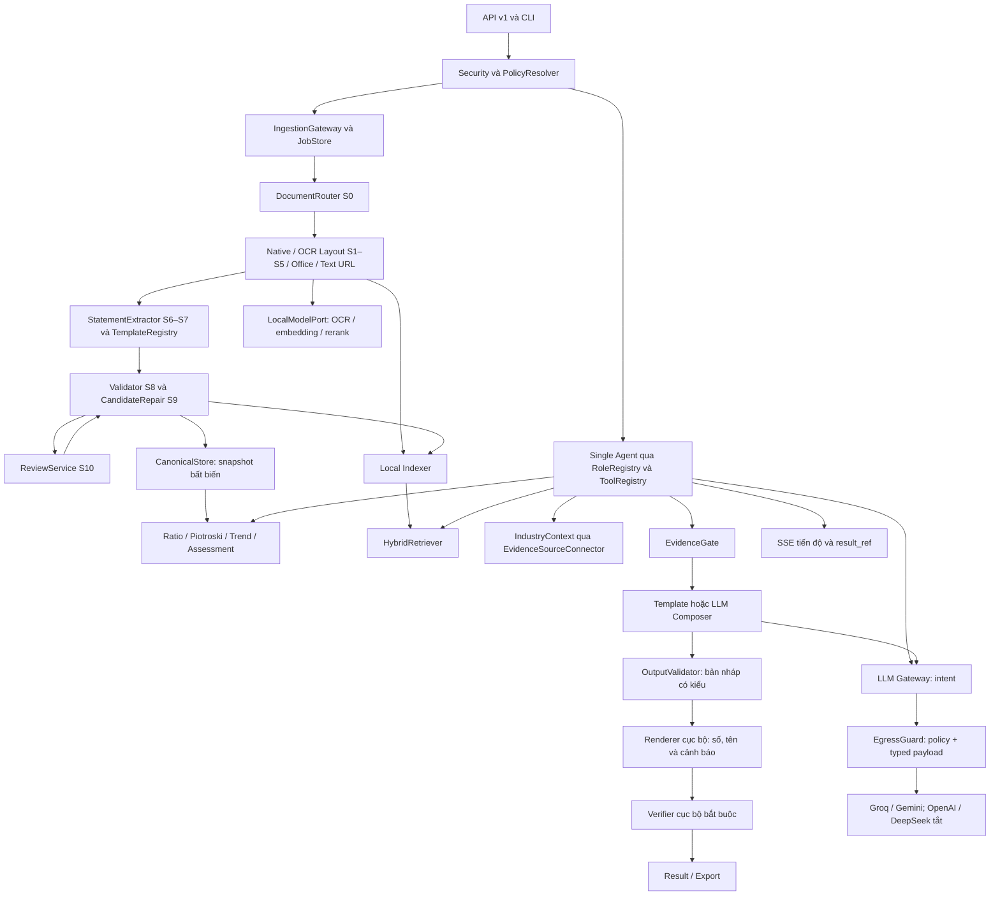

# Kiến trúc và hợp đồng backend FinAgent

Phiên bản `core-design/1`, cập nhật02/11/2026. **Chủ dự án đã freeze14 nhóm schema; Phase0 chưa đạt điều kiện kết thúc do thiếu corpus và kiểm chứng môi trường.** Đây là hợp đồng đích, không phải tuyên bố mọi module đã triển khai. Nguồn/hash: [READING_NOTES.md](READING_NOTES.md); quyết định/tham số còn cần đo: [ASSUMPTIONS.md](ASSUMPTIONS.md).

## 1. Phạm vi và bất biến

Trạng thái03/11/2026:14 nhóm frozen giữ nguyên; Phase0 INCOMPLETE/NO_GO. Chủ dự án chỉ mở ngoại lệ Phase1a tại PLAN§3.1; các mô tả đích dưới đây không có nghĩa Phase1 đầy đủ đã triển khai.

Backend theo Báo cáo chính v2.0, Phase0–6; API/CLI, không UI; chỉ `generic@1`, `spack/1`, một Orchestrator `single`. Không ship ngành/ngân hàng/IFRS, multi-agent, thị trường giá, dự báo/khuyến nghị đầu tư hay chỉ số mở rộng ngoài các biến thể tham chiếu bắt buộc.

1. Mọi số định lượng được trình bày phải có `fact_id` hoặc `calculation_id`, provenance/definition version và đối tượng/kỳ/scope chính xác.
2. Tài liệu, ảnh, raw tables và văn bản báo cáo không ra API ngoài khi chạy thật. Mạng runtime chỉ qua các adapter được cấp quyền; provider runtime chỉ nhận intent query đã che số/ẩn danh và mô tả claim mù giá trị; mọi giá trị tài chính ở lại cục bộ (D-GW-1–3).
3. D chặn mọi mode; C chỉ hiện raw kèm “chưa xác minh” trong useful theo lựa chọn A22, không chấm điểm/xếp hạng. Sai/mâu thuẫn nguồn được giữ và gắn cờ, không “sửa cho đúng”.
4. Gate → composer mù giá trị → OutputValidator → renderer/khôi phục định danh cục bộ → Verifier → HTTP/export. SSE chỉ tiến độ an toàn và result_ref; không streaming câu trả lời, không hedging (D-GW-2,6; A60).
5. Financial arithmetic dùng integer/Decimal, không float; ratio không đổi theo provider, mode, Sector Pack hoặc tin tức.
6. Append-only canonical revisions, tenant isolation, tier nghiêm nhất truyền xuống mọi derivative; thiếu policy/chứng cứ thì fail-closed.

## 2. Module, đường chạy và phụ thuộc



**Ranh giới G14:** LLM Gateway chỉ dành cho nhà cung cấp ngoài, với hai task `intent_parse` và `answer_compose`. OCR/VLM/embedding/rerank và suy luận cục bộ đi qua `LocalModelPort`, không qua provider adapters hoặc quota/keys ngoài. Local parser/template là các fallback ports được inject; Gateway không nhận snapshot/AnswerSet để chạy fallback. Tắt mọi provider vẫn giữ đường cục bộ.

Mũi tên là đường dữ liệu/gọi tại runtime, không phải import hai chiều. `validation ↔ review` trong vòng xử lý do job coordinator điều phối; hai module không import implementation của nhau.

**Đồ thị import:** schemas/ports tại `store/models` và các `contracts` của module → domain services phụ thuộc ports/schema → adapters phụ thuộc domain contracts → `api/bootstrap` ghép implementation. `analytics` chỉ nhận snapshot đã lọc từ store cùng định nghĩa/policy bất biến do caller truyền; không đọc extraction, không ghi store, không gọi API ngoài. `agent` chỉ truy cập nghiệp vụ qua ToolRegistry; `extraction` không biết analytics/Agent. Policy không import services. Chỉ `llm_gateway/adapters` được import SDK/HTTP client của provider. Gateway không import Gate, Verifier, tools, store/snapshot, corpus/teacher hoặc implementation local models; runtime composition root không import teacher/dev factory. `LocalModelPort` thuộc local contracts và được ghép tại bootstrap. Test AST/import graph kiểm cả cạnh bắc cầu và chặn mạng ngoài adapter.

Cấu trúc dự kiến theo§14:

```text
finagent/
  api/                    # /v1, schemas, composition root, SSE, CLI entry points
  ingestion/              # file, URL fetch, safety, workflow coordinator
  router/
  extraction/{pdf_text,ocr_layout,office,text_url}/
  statements/             # scope/period/unit resolution, templates
  validation/             # registry, evaluator, constrained repair
  review/
  store/                  # canonical schemas/ports/PostgreSQL/blob adapters
  retrieval/              # indexer, local embedding/rerank, BM25/hybrid
  evidence_gate/          # gate + output verifier
  analytics/{ratios,piotroski,trend,industry,assessment}/
  agent/                  # role/tool registry, single strategy, composer
  export/
  policy/                 # versioned declarative definitions, privacy, modes
  sector_packs/           # loader/schema, generic@1 only
  corpus/
  llm_gateway/
  security/
  jobs/
  observability/
tests/{unit,property,contract,integration,golden,retrieval,agent,security,load}/
eval/                     # CLI harness, dataset manifests, metric artifacts
docs/                     # tài liệu hiện tại, PROGRESS, OpenAPI, runbook khi đến phase
```

Không tạo package/framework đa-agent, nền tảng plug-in tự thực thi mã hoặc một hệ memory/ADR trùng nguồn. Dữ liệu gốc/quarantine/cache không được đặt trong đường public static của FastAPI.

## 3. Schema chung và quy ước hợp đồng

Mọi DTO được hiện thực bằng Pydantic v2, immutable khi là output/domain snapshot, `extra='forbid'`, schema version rõ ràng. Interfaces là `Protocol`/ABC, injection tại bootstrap; từng adapter phải chạy cùng contract suite. Không dùng `dict[str, Any]` thay hợp đồng tài chính.

| Schema | Trường và ràng buộc |
| --- | --- |
| `ExecutionContext` | `tenant_id`, authenticated principal/key ID, permissions, `request_id`, `trace_id`, effective policy IDs, `mode`, `source_tier`, deadline; tenant không lấy từ params do LLM gửi |
| `PolicySnapshot` | `policy_version`, resolved system/tenant/key/request limits, mode, registry/template/rule/pack versions, feature flags, ratio options, budget, retention; hash bất biến theo run |
| `DomainError` | `code`, `message_key`, safe parameters, retryable, correlation ID, missing requirements; không traceback/secret/raw input trong API |
| `Warning` | `code`, severity, `message_key`, localized message, `evidence_ids`, `affected_ids`, `assumption_ids`, blocking flag; nguyên văn receivables130 khóa riêng |
| `PeriodKey` | Tagged union `StockPeriod(as_of, fiscal_year)` / `FlowPeriod(start,end,period_type,fiscal_year,fiscal_quarter?,months?,derivation?)`; stock không được có flow interval, flow start≤end |
| `Selection` | entity, statement_family, scope, `PeriodKey`, revision policy và pinned snapshot refs; không tự chọn công ty/kỳ khi nhiều đáp án |
| `EvidenceRef` | immutable ID, fact/span/calculation ID, source observation refs, entity/scope/period/tier/trust, source revision; quyền xem kiểm tại server |
| `NumericClaim` | claim ID, Decimal/integer value, measure/unit, entity/scope/period/variant, allowed display strings, evidence/calculation refs; date/code là typed metadata khác amount |
| `PageResult[T]` | typed items, opaque `next_cursor`, limit; cursor bind tenant/filter và ACL được kiểm lại |
| `ResultEnvelope[T]` | schema version, result/run ID, effective mode/tier, policy/snapshot versions, data, warnings, missing, trace ref; metadata tier/mode vẫn có khi endpoint không dùng financial data |

`strict`/`useful`, `public`/`private`/`strict_private`, `ANSWER`/`ANSWER_WITH_CAVEATS`/`ABSTAIN` là enum riêng. `VERIFIED`/`PARTIAL`/`REJECTED` không đồng nghĩa audit status. Lỗi nghiệp vụ thiếu evidence thành kết quả có reason, lỗi malformed/schema/auth thành HTTP4xx; không biến ABSTAIN thành HTTP500.

Integer VND serialize thành chuỗi thập phân để client không mất chính xác trên53bit. Ratio lưu fraction (ví dụ ROA `0.055281350608394...`), display_kind=percent mới nhân100 ở formatter; count có measure kind riêng, percent chỉ là hiển thị ratio. Precision38, ROUND_HALF_UP và localized format theo A19/A61. Float chỉ cho thời gian/toạ độ/ML scores, không chuyển float vào amount/ratio.

**Frozen R2–R4:** bare JSON integer chỉ nhận trong ±(2^53−1); ngoài khoảng, amount/count phải là chuỗi canonical, lưu integer cục bộ. Metadata integer cũng giữ safe bound cùng ràng buộc riêng. Ratio dùng `kind=ratio`, `representation=fraction`, value string Decimal fixed-point, `scale` (số chữ số thập phân) và `rounding_mode=ROUND_HALF_UP`; `display_kind=percent` chỉ là cách hiển thị, không còn kind/measure_kind `percentage`. Ví dụ0.1250 có scale4 và hiển thị12,50%; DTO không nhân100, làm tròn hoặc quy năm. NonEmpty4096 chỉ cho trường ngắn; PageText1.000.000, ChunkText64.000, CitationText64.000, ExportText10.000.000 ký tự là trần riêng **APPROVED A61**; vượt trần báo lỗi, không cắt dữ liệu. Chi tiết tại [OpenAPI](OPENAPI.md).

## 4. Mô hình canonical và persistence (§6)

### 4.1 Thực thể

Mọi row thuộc tenant và mọi derivative có tier, timestamps, schema/pipeline version. UUID hoặc ID nội bộ không đoán được; foreign key ghép tenant để chống nối chéo tenant.

| Thực thể | Trường đặc thù và quan hệ |
| --- | --- |
| `Entity` | ID, legal name/aliases, ticker?, listing metadata+source, industry label+classifier evidence?, fiscal year start/end; industry chưa biết không suy từ ticker |
| `Document` | ID, tenant/entity?, original filename, source kind, source URL?, fetched_at, MIME, language, SHA256, blob ref, page count, declared/verified public evidence, tier, audit evidence, ingestion/job state, pipeline version |
| `Page` | ID, document ID, physical index0, human page number1, printed label?, width/height, original/rendered orientation, forward/inverse transform, kind, route, native quality, source raster/blob refs |
| `Table` | ID, document ID, ordered page segments+bbox, grid rows/columns/merged cells, table type, note number?, unit/scale+evidence, column roles with PeriodKey, completeness status |
| `SourceCell` | table/row/column IDs, role (code/note/label/value), raw text, original bbox/page, normalized candidate IDs; code/note columns không parse thành amounts |
| `Statement` | ID/revision, doc/entity/tenant, statement_family=`corporate`, template_id+version, type=B01/B02/B03/B09, scope, PeriodKey, audit_status+evidence, VND, unit_scale, verification status, restated/supersedes/source-comparison refs, completeness result |
| `LineItem` | immutable observation/fact ID, Statement revision, code string (`01`,`420b` giữ nguyên), canonical_id, labels vi/en, measure kind, original display value/unit, VND integer?, count?/Decimal?, sign, is_total/is_memo, parent, explicit_zero, presence state, dimensions, provenance IDs |
| `Provenance` | document hash/revision, physical+printed page, original bbox, transforms, cell/table IDs, engines/model versions, native/OCR/human observations, all candidates/raw strings/confidences, chosen candidate reason, A–D grade, rule runs/results, human review refs |
| `ValidationRun/Issue` | snapshot/ruleset/template version, rule ID, PASS/FAIL/NOT_EVALUATED/NOT_APPLICABLE, BLOCK/WARN/INFO, discrepancy/tolerance typed, affected cells, error origin=READING/SOURCE/CLASSIFICATION/UNKNOWN, explanation evidence |
| `ReviewCase/ReviewAction` | case ID, source revision, crops/candidates/issues, status, reviewer, action type=confirm_reading/correct_reading/acknowledge_source_conflict, before/after, reason, time, idempotency key, resulting revision |
| `DerivedFact` | calculation ID, expression+definition version, exact source fact IDs, result type/value, period/unit derivation, warnings; zero derived không gọi explicit_zero |
| `CanonicalSnapshot` | immutable ordered statement/line revision refs, entity/scope/period selection, rules/policy/pack versions, content hash, unavailable facts, conflict set; analytics nhận đúng một snapshot |
| `EvidenceChunk/Span` | document revision, text local-only, heading/note/statement IDs, original locations, period/scope/entity/tier/trust, local embedding model/index version, numeric token links to facts where verified |
| `AnalysisResult/AgentRun` | immutable snapshot/policy versions, calculations/AnswerSet/evidence refs, verdict, mode/tier, warnings, assumptions, missing, public explanation, verifier receipt, trace ref |

`dimensions` là các key khai báo trong concept registry, giá trị union typed: `counterparty_id`, `relationship`, `debt_type`, `maturity`, `measurement_basis=gross/net`, subcategory. Chúng cho phép aggregate notes sau này mà không thêm cột riêng cho từng ngành; không cho arbitrary executable metadata.

### 4.2 Khóa, bất biến, lifecycle

- Uniqueness observation: `(tenant, statement_revision, canonical_id, dimensions, source_column_identity)`; snapshot phải phân xử duplicates/conflicts tường minh. Các cột cùng Q1/YTD có thể alias cùng fact nếu khoảng thời gian và giá trị bằng nhau; vẫn giữ cả observations.
- Statement mỗi kỳ/scope/type là một instance; B01 31/12/2025 không thể đứng vào Flow Q1/2025. Gộp báo cáo để tính ratio qua `FinancialSnapshotBuilder`, không join theo “cột trước” đơn thuần.
- Original/OCR/corrected/restated cùng tồn tại; revision selection không đổi giữa một run. New revision làm invalidation cache/index/analysis qua version refs, không ghi đè lịch sử. Hai review cạnh tranh →409.
- Raw/quarantine có thể giữ REJECTED để duyệt; `CanonicalRepository.publish` từ chối REJECTED. PARTIAL chỉ publish fact không phụ thuộc BLOCK; thiếu báo cáo liên quan được báo thiếu, không giả VERIFIED cả bộ.
- Monetary normalization nhân scale có provenance; nguồn foreign currency không đổi sang VND bằng tỷ giá đoán. Table không xác định đơn vị →UNIT_AMBIGUOUS, chặn normalization.
- `explicit_zero=true` chỉ khi đọc ký tự0/gạch hợp lệ ở đúng ô value. `presence=MISSING` value null; negative parentheses giữ dấu; `derived_zero` cần equation lineage.
- `VERIFIED` về số học không có nghĩa đã kiểm toán. `audit_status=unknown` không được nâng thành audited từ câu TM21 nói số so sánh năm trước audited.
- Hash dedup theo tenant+pipeline+source revision; dùng cùng bytes giữa tenant không tiết lộ tài liệu tồn tại. Blob/index/vector/cache/events/crops/audit có cùng ACL.

### 4.3 Storage ports và giao dịch

`CanonicalRepository.publish(validated_bundle, expected_revision, ctx) -> SnapshotRef`; `read_snapshot(selection, ctx) -> CanonicalSnapshot`; `list_periods(entity, ctx)`; `get_note_table(ref, ctx)`; `get_validation_report(ref, ctx)`; `revisions(ref,ctx)`.

`BlobStore.put(stream, metadata,ctx) -> BlobRef`; `open(ref,ctx)`; `crop(ref,bbox,transform,ctx) -> CropRef`; `purge(document_ref,ctx) -> PurgeReport`. Đĩa local dev, S3-compatible adapter theo cùng contract khi cần, không provision dịch vụ ngoài ở core mặc định.

PostgreSQL là authoritative store. Publish statement+provenance+issues+revision pointer atomic; outbox event trong cùng transaction rồi job worker cập nhật index. Queue delivery at-least-once, handler idempotent. Không hứa transaction chung Redis/Postgres; DB/outbox là nơi khôi phục. In-memory mode là dev/test có cùng semantics, restart không giữ queue được nêu rõ; job bền vững cần Redis+Postgres checkpoint. Migration chỉ schema dev ở phase được phép; không migrate real data tự động.

## 5. Hợp đồng từng module (§4.3, §12, §14)

Các signatures mô tả giao diện cần triển khai; `ctx` luôn bắt buộc, batch methods trả per-item outcome thay vì nuốt lỗi. Mỗi dòng cần suite `tests/contract/<module>` kiểm schema, invariant, timeout/error và tenant/tier propagation thích hợp.

| Module / Protocol | Interface chính → output schema | Điều kiện và phụ thuộc |
| --- | --- | --- |
| `ingestion / IngestionGateway` | `submit(FileInput\|UrlInput\|TextInput, ctx) -> IngestionReceipt(document_id,job_id,dedup_hit)` | Auth/limits/MIME/safe archive/URL trước enqueue; idempotency match-body, hash versioned |
| `router / DocumentRouter` | `route(DocumentRef,ctx) -> PagePlan[]` | Mỗi trang text/ocr/hybrid, quality reasons, orientation; không chọn một đường cho cả file |
| `extraction.pdf_text / NativeExtractor` | `extract(PageRef,ctx) -> PageExtraction` | Words+bbox+source offsets, tables candidates; numeric values vẫn phải qua normalization/validation |
| `ocr_layout / ImagePreprocessor` | `prepare(PageRef, RenderPolicy,ctx) -> PreparedPage` | Ảnh gốc/clean/transforms/DPI; CPU default, no outbound |
| `ocr_layout / LayoutEngine` | `detect(PreparedPage,ctx) -> LayoutResult(blocks,regions,table_candidates)` | Page kind, signature/mask evidence, geometry original-mappable |
| `ocr_layout / TableEngine` | `structure(LayoutResult,ctx) -> GridTable[]` | Header/role/merged cell/row anchors, continuation candidates |
| `ocr_layout / OcrEngine` | `read_cells(CellBatch,EngineOptions,ctx) -> CellReading[]` | Typed raw candidates with engine/version/confidence, CPU/GPU capabilities; ≥2 independent readings cho OCR |
| `extraction / NumberNormalizer` | `normalize(RawNumericCell,UnitContext,LocalePolicy) -> NormalizationResult` | Integer amount/explicit_zero/format errors; không LLM, không float, không đổi source cell |
| `office / OfficeExtractor` | `extract(DocumentRef,ctx) -> DocumentExtraction` | Excel sheets/merged/formula+cached value; Word nested tables/images; external links/macros không thực thi; embedded images đi OCR |
| `text_url / TextExtractor` | `extract(TextArtifact,ctx) -> TextDocument` | Sanitized local spans/table candidates/publish date; URL news context-only, official report URL phải phân loại document |
| `statements / StatementExtractor` | `build(DocumentExtraction,TemplateRegistry,ctx) -> DraftStatementBundle` | S6–S7 ghép trang/mapping/period-unit-scope; Unknown/Ambiguous không guess |
| `validation / Validator` | `validate(DraftStatementBundle,RuleSet,ctx) -> ValidatedBundle` | Mọi rule có kết quả, trust/completeness/issues/per-fact eligibility |
| `validation / CandidateRepair` | `propose(ValidatedBundle,ctx) -> RepairProposal[]` | Chỉ candidates quan sát được, nghiệm duy nhất, bounded search; coordinator mới revalidate |
| `review / ReviewService` | `list_cases(filter,ctx)`, `get_case(id,ctx)`, `resolve(ReviewDecision,ctx) -> ReviewResolution` | Review/admin permission; optimistic revision, audit, source conflict giữ nguyên, revalidate publish revision |
| `store / CanonicalRepository, BlobStore` | Các ports ở mục4.3 | Immutable, atomic publish, no REJECTED analysis, no tenant leakage |
| `retrieval / Indexer` | `index(ValidatedContentRef,ctx) -> IndexReceipt` | Chunk theo heading/note, loại cover/toc/signature khỏi numeric index, local embedding; rejected data không làm nguồn số |
| `retrieval / HybridRetriever` | `search(EvidenceQuery,ctx) -> EvidenceSet` | Entity/scope/period/tenant/tier filter trước rank; local BM25+vector, reciprocal-rank fusion và local rerank; sources with locations |
| `evidence_gate / EvidenceGate` | `evaluate(EvidenceRequirements,EvidenceSet,AnswerSet,ctx) -> GateVerdict` | Hard predicates + missing/next tools allowed; không LLM decision |
| `analytics.ratios / RatioKernel` | `compute(CanonicalSnapshot,RatioRequest,DefinitionSet,ctx) -> RatioBatch` | Pure Decimal DSL,15core+declared variants; applicability và min-input confidence; không đọc source raw |
| `analytics.piotroski / PiotroskiEngine` | `compute(ComparableSnapshots,PiotroskiPolicy,ctx) -> PiotroskiResult` | 9components, availability, interval, basis/mode, no missing=0 |
| `analytics.trend / TrendEngine` | `compute(RatioSeries,TrendPolicy,ctx) -> TrendResult`; `compare(TwoSnapshots,ctx) -> PeriodComparison` | <3điểm chỉ change, comparable flags, delta ratio/money derived locally; nguyên nhân chỉ có evidence |
| `analytics.industry / IndustryContextService` | `list(ContextQuery,SourceConnector[],ctx) -> IndustryContext` | Sources/title/date/trust/citations, no model summary, no financial facts overwrite |
| `analytics.assessment / AssessmentEngine` | `assess(AnalysisBundle,SectorPack,ScorePolicy,ctx) -> AssessmentResult` | Strict mode, coverage, approved score policy, contributions/caps/confidence separate; policy draft →POLICY_UNAPPROVED |
| `agent / AgentRunner` | `run(AgentRequest,ctx) -> AgentResult`; `events(run_id,cursor,ctx) -> Event[]` | Một strategy single qua RoleRegistry/ToolRegistry; collect typed evidence, bounded calls, Gate mandatory |
| `agent / Composer` | `compose(ValueBlindComposeView,ctx) -> AnswerDraft` | Chỉ claim descriptors ở §10.1; caller giữ ApprovedAnswerSet cục bộ. Template cũng trả cùng typed draft, không prose chứa số/tên |
| `evidence_gate / OutputVerifier` | `verify(RenderedAnswer,AnswerSet,EvidenceSet,ctx) -> VerifiedOutput\|VerificationFailure` | Sau OutputValidator và renderer; kiểm binding giá trị/khái niệm/kỳ/scope/cờ/ACL, mọi sink cần receipt |
| `llm_gateway / OutputValidator` | `validate(AnswerDraft,ReferenceManifest,ctx) -> ValidatedDraft\|DraftRejected` | Manifest không có giá trị; schema, prose, refs và required claims/warnings/status phải đạt trước renderer; dùng chung cho template |
| `agent / LocalRenderer` | `render(ValidatedDraft,ApprovedAnswerSet,LocalIdentityMap,ctx) -> RenderedAnswer` | Chèn nguyên văn formatter values và warning dictionary, gắn claim với nhãn/kỳ/scope; không gọi model |
| `local / LocalModelPort` | `infer(LocalModelRequest,ctx) -> LocalModelResult` | Task/capability typed cho OCR/VLM/embedding/rerank; local process/artifact, không proxy ra ngoài |
| `export / Exporter` | `export(VerifiedRunRef,ExportRequest,ctx) -> ExportArtifact` | JSON/Markdown, Excel kiểm toán được; official strict re-evaluate rồi reverify; công thức/provenance/warnings, chống spreadsheet injection |
| `policy / PolicyResolver` | `resolve(AuthContext,RequestOverrides) -> PolicySnapshot` | Cấp con trong bounds cha; paid/private egress/flags default deny; invalid config fail startup |
| `security / AccessPolicy, EgressGuard` | `authorize(resource,permission,ctx)`; `approve(EgressPayload,ctx) -> EgressPermit\|Denied` | ACL trước read/write; one-use permit binds payload hash, tier/task/provider; không downgrade |
| `jobs / JobStore, JobQueue` | `enqueue`, `claim`, `checkpoint`, `complete`, `retry`, `status`, `events` → `JobReceipt/JobStatus` | Memory/Redis parity, leases, retry budget, per-stage dedup; state machine ở mục11 |
| `observability / TraceSink` | `record(ExecutionEvent,ctx) -> EventRef`; `metrics(MetricBatch)` | Structured traces, correlation,parent span, masked metadata; private local storage, no raw CoT |
| `llm_gateway / LlmGateway` | `parse_intent`, `compose_answer` → `GatewayOutcome` ở §10 | Chỉ hai task nhà cung cấp ngoài; mock+4 adapters; local fallback ports được inject và không mang dữ liệu nghiệp vụ vào Gateway |
| `corpus / CorpusRepository, EvaluationRunner` | `register(DatasetEntry,ctx)`, `freeze(SplitManifest,ctx)`, `evaluate(EvalSpec) -> EvalReport` | License/source/tier/gold approval/entity split/hash/version; no private training or benchmark leakage |

## 6. Template, rule registry và catalog kiểm tra (§7)

### 6.1 Hợp đồng khai báo

`StatementTemplate`: `template_id`, version, family, accepted statement types, source authority/effective dates (nullable khi chưa xác minh), recognition features+evidence requirement, code→canonical mapping, bilingual aliases, column patterns, units, parent relations, signed rollups, memo exclusions, required/optional rows, closed-world completeness proofs, associated ruleset, approved status, test case refs.

`ValidationRule`: `id`, version, template IDs/range, group A–F, severity, preconditions, typed input selectors, expression AST, tolerance mode, affected facts, failure message key, error-origin policy, test cases. Unknown rule/operator/reference bị từ chối lúc nạp. Rules không thực thi Python hoặc truy cập OS/network.

Ngôn ngữ an toàn chung cho ratio/rules: typed literal/fact/ref; `+,-,*,/`, `sum`, `avg`, `min/max`, `abs`, comparisons, boolean and/or/not, `if`/`coalesce_missing` có ghi assumption, safe conditional aggregation trên dimensions đã khai báo. Không variable/function tùy ý; số node/depth/cardinality bị giới hạn; divide-by-zero là domain outcome. `coalesce_missing` không được biến missing thành0 cho fact tài chính không có căn cứ. Unit/time/scope type checker chặn expression không tương thích. RatioDefinition chỉ được signed/versioned release; SectorPack tham chiếu definition, không truyền replacement AST.

### 6.2 Catalog tối thiểu phải triển khai

| Rule ID | Nhóm / phép kiểm | Mức và hành vi |
| --- | --- | --- |
| A001 | Ký tự/group3/locale, dấu âm,0/missing | BLOCK normalization ô lỗi; lưu raw |
| A002 | Role cột code/note/value, số lượng cột, merged/header match | BLOCK ô lệch cột; không đọc4/7 thành amount |
| A003 | Currency/unit/scale rõ và nhất quán theo bảng | BLOCK unit ambiguous; bảng giải trình triệu là secondary |
| A004 | Bbox/lineage/period/code mapping hợp lệ | BLOCK không provenance/template mapping |
| B001 | `100=110+120+130+140+150+160` theo đúng rows của template | BLOCK; row optional chỉ bỏ theo completeness proof của template, không missing=0 |
| B002 | Mọi total/parent signed children ở100/130/140/160/200/210/220/221/227/250/260/270/300/310/330/400/420 và total khác template | BLOCK; mỗi direct child một lần, dự phòng âm đúng dấu, memo không cộng thêm |
| B003 | `280=100+200`; `440=300+400`; `280=440` | Core BLOCK; fail không sửa duy nhất →REJECTED |
| B004 | B02 `10=01−02`, `20=10−11` | BLOCK theo template |
| B005 | B02 mẫu FPT `30=20+22−23−25−26`;24 là memo | BLOCK; template cũ21 không tự dùng mapping22 |
| B006 | B02 `40=31−32`, `50=30+40`, `60=50−51−52` | BLOCK |
| B007 | B03 indirect `08=sum(01..06)` theo signed mapping;20/30/40 tổng dòng theo template | BLOCK, không ép dòng cash out từ âm thành dương |
| B008 | B03 `50=20+30+40`, `70=50+60+61` | BLOCK số học; nhãn công thức in thiếu61 xử lý riêng ở E006 |
| C001 | CF70=B01-110 tại đúng end date/scope | BLOCK exact; thiếu B01 kỳ so sánh →NOT_EVALUATED |
| C002 | B02-60=B01-420b=TM14 profit trong kỳ | BLOCK chỉ khi accounting period của420b đúng flow được đối chiếu; không so annual420b vớiQ1 |
| C003 | B02-50=CF01 (indirect) | BLOCK; direct CF không áp |
| C004 | TM5+TM6 depreciation=CF02, note roll-forward đúng kỳ | BLOCK hoặc WARN với bridge khác phân loại được duyệt |
| C005 | Beginning note balance=previous closing cùng concept | BLOCK trong một bundle đầy đủ; liên document xem D001 |
| C006 | Cross-note detail tổng/roll-forward=main statement cùng basis | BLOCK khi cùng nghĩa, WARN nếu documented classification bridge; không ép gross=net |
| D001 | Opening balance current vs closing prior admitted revision | WARN/restated/CONFLICTING_SOURCES; không overwrite |
| D002 | Prior-year flow/ytd comparative vs report prior cùng interval | WARN/restated, không tráo31/12 với31/03 |
| D003 | Q1/YTD alias và quarter derivation không chồng | BLOCK nếu nhầm/cộng đôi period; differing comparison figures phải có conflict |
| E001 | Revenue/assets sign và contra-account exceptions | WARN hợp lý, không sửa dấu tự động |
| E002 | Capital/par_value=issued shares, treasury shares distinction | WARN `SOURCE_INCONSISTENCY`; FPT31/12/2025 giữ số gốc |
| E003 | Interest cost≤finance cost | WARN; FPT giải thích bởi net FX trong TM18; không D chỉ vì heuristic |
| E004 | Effective tax reasonableness/declared reconciliations | WARN theo context; không hard-code luật thuế chưa xác minh |
| E005 | Holdings/dividend/related-party concentration evidence | WARN/applicability flags, không thay amount |
| E006 | Nhãn công thức in không đầy đủ nhưng các ô khớp phương trình đúng | INFO `SOURCE_FORMULA_LABEL_INCOMPLETE`; giữ nhãn và số nguồn, không sửa theo nhãn thiếu |
| F001 | Entity/scope/family/template compatibility trong bundle/calculation | BLOCK; hỏi consolidated trên separate→SCOPE_MISMATCH |
| F002 | Flow interval/stock dates/fiscal calendar/basis join | BLOCK khi mismatch; missing period thành unavailable |
| F003 | Normalize unit/currency before combining; value type match | BLOCK; không cộng count với VND |
| F004 | Required B01/B02/B03/notes and comparisons completeness | Report requirements/missing; block tác vụ cần phần thiếu, không cấm phần độc lập |

Rule registry phải enumerate **mọi total của template đã hỗ trợ**, không chỉ các ví dụ trên. Đánh giá exact VND tolerance0; nguồn rounded±1 display unit bằng VND tương ứng, giá trị nguồn lưu như đã đọc không sửa theo tolerance. Warn không tự chuyển đúng OCR sang D. Confidence có native/format/consensus/equation/human components, không giả xác suất thống kê trước calibration. Repair chỉ sau rule result, không được thay nhãn vàng.

## 7. Analytics và Ratio Registry

### 7.1 Schemas và 15 định nghĩa

`RatioDefinition`: id/version/status(core|experimental|extended), name/i18n, pillar memberships, safe formula AST, inputs+time/basis/scope/measure requirements, variants, applicability rules, allowed options, warning rules, direction/bands/source, approval/test refs.15core không sửa runtime; tham chiếu nợ vay nằm `extensions.reference_metrics`, không biến thành bộ17core.

`RatioResult`: ratio_id/definition_version, exact decimal fraction?, display unit, `availability=AVAILABLE|N_A|MISSING|BLOCKED`, reasons, applicability=`APPLICABLE|NOT_MEANINGFUL|NOT_APPLICABLE|UNKNOWN`, formula AST/ID, variant, basis, period/scope, input values+fact/provenance IDs, min confidence, verification status, warnings, assumption IDs, pack/policy versions. `N_A` không là0 hoặc∞. Per-period và annualized là hai result riêng; số hiển thị do formatter tạo và được thêm vào AnswerSet.

| ID | Biểu thức chính (mã minh họa template FPT) | Biến thể/cờ bắt buộc |
| --- | --- | --- |
| current_ratio | B01-100/B01-310 | denominator≤0→N/A |
| quick_ratio | (100−140)/310 | variant phụ `(110+120+130)/310` phải có ID riêng, không coi hai công thức luôn bằng |
| cash_ratio |110/310 | expanded `(110+120)/310`, warning120 không hoàn toàn cashlike |
| debt_ratio |300/280 | reference interest-bearing_debt/280, không chấm |
| debt_to_equity |300/400 | equity≤0→N/A+risk; reference borrowing/400 |
| interest_coverage |(B02-50+B02-24)/B02-24 | zero interest→NO_INTEREST_EXPENSE, không∞; có thể EBIT âm, không chặn numerator âm; holding dividend warning |
| inventory_turnover |B02-11/avg(B01-140 opening,closing) | inventory immaterial+evidence→N/A; raw calculation không được diễn giải như applicable |
| receivables_turnover |B02-10/avg(B01-131 opening,closing) | thiếu131 mới130;131explicit0→N/A;130 warning exact; intragroup services→NOT_MEANINGFUL |
| asset_turnover |B02-10/avg(B01-280 opening,closing) | holding→NOT_MEANINGFUL |
| gross_margin |B02-20/B02-10 | %display, không annualize |
| net_margin |B02-60/B02-10 | holding→NOT_MEANINGFUL, dividend flag |
| roa |B02-60/B01-280 closing | average biến thể riêng; quý chưa annualize không so ngưỡng năm |
| roe |B02-60/B01-400 closing (separate) | consolidated parent profit/parent equity từ template; average variant riêng |
| ocf_current_liabilities |CF20/B01-310 closing | giữ âm, period threshold matching, cổ tức CF investing warning |
| ocf_total_assets |CF20/B01-280 closing | giữ âm; %display |

Applicability rules declarative trong Registry/pack; cùng calculation value nhưng có thể thay status/interpretation. Bộ chung nhận diện cấu trúc holding/tổ chức tài chính, không tự phân ngành công nghệ. Các ngưỡng provisional tại A20–A24 cần test bao biên và chuyên gia duyệt. Nguồn C không đủ chuẩn analytics theo A22; useful vẫn có thể hiện raw có nhãn, không mất cảnh báo qua composer/export.

### 7.2 Kho ngưỡng và phần chưa chốt

Threshold schema: `ratio_id`, definition/basis/period applicability, boundary decimal+inclusive flags, label/direction, source section, benchmark sample/date?, status=draft/approved, conflict notes. Không chấm chỉ số theo ngưỡng sai period, N/A, NOT_MEANINGFUL hoặc unapproved band.

| Ratio | Ngưỡng có trong file chỉ số | Vấn đề phải giữ rõ |
| --- | --- | --- |
| Current |<1 yếu;>1 đủ;1,5–2,5 “tốt nhất” | exactly1,>2,5 và mapping3band chưa đủ |
| Quick |<1 thiếu;>1 đủ | exactly1 chưa định nghĩa good/medium đầy đủ |
| Cash |<1 chưa đủ tiền ngay;>1 đủ | không có3band, không được gán cash<1 luôn mất khả năng thanh toán |
| Debt |0,5 cutoff rủi ro;0,4–0,6 “lý tưởng” | CONFLICTING; draft ưu tiên risk cutoff, chuyên gia duyệt |
| D/E |<1 an toàn;>1 rủi ro;1–2,5 “lý tưởng” | CONFLICTING; không áp ngành riêng hoặc ngưỡng ngân hàng |
| ICR |<1,5 yếu;1,5–3 vừa;>3 tốt | “<2 xem xét” là advisory,3–5 tối ưu không đổi3band |
| Inventory turnover |<3/năm thấp;>5 cao | khoảng[3,5] đề xuất medium, cần duyệt |
| Receivables turnover |<4 thấp;>7 cao;5–7 hợp lý | khoảng[4,5) chưa rõ, cần duyệt |
| Asset turnover |<1 thấp;>1,5 cao;1,2–2 tối ưu | khoảng và chồng không được tự thống nhất |
| Gross margin |<20% thấp;>40% cao;25–50% trung bình | overlap40–50, gap20–25 |
| Net margin |<5% yếu;5–15% vừa;>15% tốt | tương đối đầy đủ, inclusive endpoints explicit |
| ROA |<5%;5–10%;>10% | chỉ cùng time basis, không áp trực tiếp quý |
| ROE |<10%;10–15%;>15% | như ROA |
| OCF/current liabilities |<0,5;0,5–1;>1 | nguồn không nói annualization; cần approve matching policy |
| OCF/assets |<0,1;0,1–0,2;>0,2 | cuối file10–20% “tối ưu” khác>20% “mạnh” |

Chủ dự án duyệt **profile generic v0 làm cơ sở**, chưa duyệt kết quả trên kho: good100/medium50/weak0, năm trụ đều20%, ratio trong trụ đều, grade≥75 tốt/≥50 trung bình/còn lại yếu. Khoảng chồng hoặc hở giữ UNCLASSIFIED, không chấm. N/A bỏ denominator membership; NOT_MEANINGFUL/C/unknown band không điểm và giảm coverage; giữ≥ceil(2n/3) trong trụ,≥3trụ mới tổng. OCF14 hiển thị liquidity và cashflow nhưng **chỉ chấm một lần ở cashflow**, công bố rõ tác động. Equity âm →grade tối đa yếu; OCF kỳ âm và ICR<1,5 →tối đa trung bình; chưa VERIFIED/thiếu coverage →không grade; chỉ nói kéo dài khi Trend đủ kỳ. Piotroski/Trend modifier=0 tới khi duyệt lại. Đầu ra phải ghi đây là quy ước theo ngưỡng file chỉ số, chưa phải mô hình kiểm chứng và không là khuyến nghị đầu tư. **POLICY_UNAPPROVED vẫn giữ đến khi chủ dự án duyệt kết quả chạy trên kho**, không tự publish profile thành approved để phát hành rating.

### 7.3 Piotroski, trend, Assessment

`PiotroskiPolicy`: annual default/same_quarter_yoy/TTM; ROA basis; debt basis; comparable-period selector; label thresholds; min available9strict/7useful. `ComponentResult`: F1..F9, condition,0/1/UNAVAILABLE, reason,input IDs/formula, current/comparative values, confidence. Kết quả: earned score, available/unavailable count, min/max, label nullable, mode/basis, flags. F1 ROA>0; F2 CFO>0; F3 ΔROA>0; F4 CFO>NI; F5 long-term leverage giảm; F6 CR tăng; F7 không phát hành; F8 GM tăng; F9 ATO tăng. Không dùng31/12/2025 thay31/03/2025 cho F3/5/6/9 cùng-quý. F7 FPT dùng capital roll-forward và giữ source-conflict warning theo A30.

`TrendResult`: comparable points with revisions/trust/gaps/restatements, period-to-period absolute/relative changes, direction/method/confidence+reasons; <3point không label trend; zero/negative baseline không ra percent growth gây hiểu sai, trả absolute change+N/A relative. Suggestion of cause phải có source fact/span, không causality từ tương quan.

`AssessmentResult`: strict effective mode, pack/score policy/definitions, ratio contributions, pillars(scores,weights,eligible counts,coverage), total score nullable, grade nullable, confidence(grade+explanation, không giả probability), hard caps+evidence, disabled/active modifiers, reason codes. Cờ vốn chủ âm, OCF âm kéo dài+ICR<1,5, verification/coverage thiếu phải được thực thi khi policy cap đã duyệt; chưa biết cap không phát grade. Piotroski/trend tách output, modifier0 tạm thời theo A27; industry không được truyền vào scoring function ngoài cờ hiển thị và approved threshold selection. Export công bố contributionOCF14 ở cả hai trụ theo§9.6, không che trọng số lặp.

## 8. Danh mục công cụ Agent (§10.2)

`ToolSpec`: name/version, description key, input/output JSON schema, required permission, side_effect flag, timeout, max calls, allowed roles, handler port, task classification và data-access policy. Server inject context; LLM không tự cấp tenant/role/permission/effective mode. Kết quả `ToolResult[T]` có tool_call_id, typed payload, evidence/calculation IDs, tier, warnings/missing, safe trace summary. Unknown tool/schema extra/unsafe expression bị reject.

| Tool | Input schema cốt lõi (ngoài ctx) | Output schema / quyền |
| --- | --- | --- |
| `list_documents` | entity?,status?,scope?,cursor?,limit | `PageResult[DocumentSummary]`; document:read |
| `get_document_status` | document_id | `DocumentStatus(job,stages,completeness,verification,review_count)`; document:read |
| `list_periods` | entity_id,scope?,statement_type? | `AvailablePeriod[]` có audit/revision/type; statement:read |
| `get_statement` | Selection,statement_type | `StatementView` từ admitted revision+provenance refs; statement:read |
| `get_note_table` | document_id,note_number,table_id?,PeriodKey? | `NoteTableView` local-only, typed facts+locations; statement:read |
| `search_evidence` | query,entity/scope/period filters,document_ids?,top_k bounded | `EvidenceSet` với source spans local-only; evidence:read |
| `get_validation_report` | statement_id hoặc snapshot_id,rule_group? | `ValidationReport` runs/issues/cell trust/completeness; statement:read |
| `compute_ratios` | Selection,ratio_ids?,cash_basis?,receivables_basis?,period_basis? | `RatioBatch(core,variants,reference_metrics)`; analysis:read |
| `compute_trend` | Selection/ratio_id,period_sequence,comparison_mode | `TrendResult`; analysis:read |
| `compute_piotroski` | entity/scope,period,comparison_mode,basis policy ID | `PiotroskiResult`; analysis:read |
| `compare_periods` | first/second Selection,line_ids/ratio_ids?,basis | `PeriodComparison` deltas+lineage, explanation evidence; analysis:read |
| `get_industry_context` | entity?,industry?,as_of?,approved_source_ids? | `IndustryContext` source list/date/trust/citations; context:read; connector egress permission riêng |
| `assess_health` | Selection,pack_ref=generic@1,score_policy_ref | `AssessmentResult`; analysis:read; tự force strict |
| `request_review` | target observation/issue IDs,reason,expected_revision,idempotency_key | `ReviewReceipt`; review:request, **có side effect**; không tự resolve/correct |
| `explain_ratio` | ratio_id,definition_version,variant?,language | `RatioExplanation` approved formula/thresholds/limitations/source refs; registry:read |
| `export_result` | run_id, format=json/md/xlsx, purpose=interactive/official | `ExportArtifactRef`; export:create; official strict + full reverify |

16tool, không calculator/code execution/free SQL/free HTTP tool. `get_note_table/search_evidence` trả nội dung **cho local tool collector**, không đẩy response thô trở lại external model. Agent dùng local state machine chọn bước bổ sung; external intent parser chỉ chọn action+params từ câu hỏi, không có vòng “tool results → model planner” chứa tài liệu.

Role contract `RoleDefinition`: id/version, purpose, allowed tool names, model-task route refs, input/output schema refs, budgets(steps,tokens,time), guardrail policy refs, status. `RoleMessage`: message_id,run_id,parent_id,from/to_role,purpose,typed input/output refs,evidence_ids,context/policy/tier,budget_consumed,trace_parent; không số tự do trong message. Core register Orchestrator single, Verifier là service tất định cuối; không spawn vai trò độc lập hay supervisor. Yêu cầu strategy chưa triển khai →UNSUPPORTED_STRATEGY, không fallback ngầm sang multi-agent.

## 9. Retrieval, Evidence Gate, AnswerSet và Verifier

`EvidenceQuery`: normalized local query+typed requirements, entity/scope/period/doc selector, trust threshold, source categories, top_k, policy version. `EvidenceSet`: ranked evidence IDs, rank signals, location metadata, locally held snippets, numeric fact links, coverage map, missing and conflicts. Hybrid dùng local embedding và BM25; fusion/reranking không được loại bỏ hard filters. Không làm remote embedding/rerank cả với public.

`EvidenceRequirements`: atomic requested claims, essential/optional inputs, expected scope/period/basis, accepted evidence kinds, audit/trust limits. `AnswerSet`: typed final facts/calculations + approved definition constants/metadata, allowed numeric rendering, warning/status bindings, required caveats, scope/entity/period, local evidence table. `GateVerdict`: verdict, per-criterion outcome, essential_missing, caveats, required next actions, permitted supplemental tools; không scalar confidence che hard fail.

| Điều kiện | Strict | Useful |
| --- | --- | --- |
| Sai tenant/entity/scope/kỳ, unit chưa biết, REJECTED, thiếu thiết yếu | ABSTAIN | ABSTAIN |
| A/B admitted, essential đủ, không mâu thuẫn liên quan | ANSWER hoặc CAVEATS nếu audit/applicability có cờ | Như strict |
| Thiếu phần phụ nhưng phần trả lời có direct evidence | CAVEATS cho phần có chứng cứ, bỏ claim thiếu | CAVEATS và nêu missing |
| Raw C | Chặn, yêu cầu review | Hiện với “chưa xác minh”, CAVEATS, không tính/chấm từC theoA22 |
| D | Chặn | Chặn |
| NOT_MEANINGFUL | Có số nếu đủ trust, CAVEATS, không score | Như strict |
| Textual Q claim | Direct local span cho từng claim; thiếu thì bỏ/ABSTAIN | Có thể assumption rõ; core vẫn kiểm mọi assertion theo mẫu/local evidence |
| Piotroski label | đủ9 + label policy approved | ≥7 + label policy approved |
| Assessment / official export | Force strict | Force strict và trả effective mode rõ |

`VerificationReport`: numeric claims matched/unmatched/misbound, entity/period/scope violations, unsupported statements, dropped/altered warnings, source permission errors, output hash, verifier version. `VerifierReceipt`: binds output hash+AnswerSet hash+snapshot+effective policy+mode, không tái dùng với output đã sửa.

Kiểm số phải bao gồm âm/ngoặc, dấu chấm-phẩy, tỷ/triệu/VND, phần trăm, số viết bằng chữ, kỳ/ngày/mã/công thức/trang; metadata được whitelist typed theo run. Một giá trị ROE có trong AnswerSet không cho phép gán thành ROA; cùng năm2026 không cho phép Q1→Q2. Local spans có chữ số chưa chuẩn hóa không được hợp thức hóa thành fact tài chính; câu trả lời trích xuất dùng nguyên span gắn `source_quote`, nhãn unverified nếu chứa số chưa được admission, hoặc chặn phần số theo mode. Core ưu tiên template/structured claim spans để kiểm định nghĩa rõ; không tuyên bố một regex có thể chứng minh mọi mệnh đề tự do.

OutputValidator chặn draft sai trước renderer; không dùng Verifier để hợp thức hóa prose số/tên hoặc ref lạ. Khi lỗi có thể quy cho bản nháp, tối đa một lần recompose theo budget A34, chỉ gửi mã lỗi không giá trị rồi fallback template. Lỗi do renderer/binding phải bị Verifier chặn và quy đúng tầng; không gửi số sai trở lại model. Template cũng qua OutputValidator → renderer → Verifier; còn lỗi thì ABSTAIN cấu trúc tối thiểu không số sai. Chế độ local fallback vẫn đi đúng Gate/Verifier. Tóm tắt báo cáo là extractive local, không dùng external model để paraphrase văn bản nguồn. Logs và events không chứa AnswerDraft bị chặn.

## 10. LLM Gateway (§12.5, §24; thiết kế Gateway §§1–19)

D-GW-1–8 ưu tiên hơn các đoạn cũ mâu thuẫn trong thiết kế: không data_use, composer values, routes cố định hoặc tenant-stable tokens mặc định. Không with_values ở bất kỳ tầng nào. A53–A60 được duyệt theo mức ghi ở ASSUMPTIONS; tham số chưa đo chờ P6.04. A54 không history, A60 progress-only SSE; A61 đã được duyệt cùng lệnh freeze P0.05.

### 10.1 Hợp đồng và ranh giới dữ liệu

Tất cả DTO strict/extra-forbid. `gateway/1` dùng hai task `intent_parse | answer_compose`; không image/PDF/embedding/report-summary capability. `parse_intent(IntentPayload,ctx) -> GatewayOutcome[IntentPlan]`; `compose_answer(FinalAnswerPayload,ctx) -> GatewayOutcome[AnswerDraft]`. Các kiểu tài chính đầy đủ `AnswerSet/NumericClaim` chỉ ở caller/renderer/Verifier; không import vào Gateway.

| Schema | Trường / bất biến |
| --- | --- |
| `IntentPayload` | Query đã guard, che số tài chính do user nhập và ẩn danh; entity token, typed period/scope selectors, danh mục action/concept/ratio enums, language/prompt version; chỉ lịch sử user đã xử lý lại như §10.2. Không assistant answers, tool results, bảng/snippet, URL/path định danh hoặc tên thật |
| `IntentPlan` | `actions[]` trong finite read-only intent menu; ratio/concept IDs, entity token, typed period/scope; `clarification: null \| ENTITY \| PERIOD \| SCOPE \| RATIO \| AMBIGUOUS_REQUEST`. Đây là enum nullable, không câu hỏi làm rõ tự do; missing selectors được xác định cục bộ để sinh một câu gộp |
| `verify_user_claim` intent | Chỉ `placeholder_id` cùng concept/ratio và selectors; local dispatcher tra giá trị trong run-local map, truy canonical và so sánh cục bộ. Không phải công cụ thứ mười bảy; không coi số user là fact |
| `FinalAnswerPayload / ValueBlindComposeView` | Claim descriptors chỉ có `claim_id, concept_label, status, band, qualitative_relations, warning_codes, period_code, scope`; entity tokens ngẫu nhiên theo run ở context. `band=weak\|medium\|good\|unscored` và relations được tính cục bộ từ policy đã duyệt; thiếu policy →unscored. Không amount/ratio/percent/count, số làm tròn, đơn vị mang giá trị, inputs, citations, raw evidence, tên hay đoạn giải thích chứa số |
| `ReferenceManifest` | Allowed claim IDs/required claim IDs; allowed/required warning codes; allowed entity tokens; trạng thái/kỳ/scope/render slots phải giữ. Không có giá trị tài chính. Gateway OutputValidator nhận manifest này, không AnswerSet. Chi tiết slots/prose guard là A53 |
| `AnswerDraft` | `segments: (ProseSegment \| ClaimRefSegment \| WarningRefSegment \| EntityRefSegment)[]`, discriminant `type`. `prose{text}` cấm mọi chữ số và tên thật; `claim_ref{claim_id,render: value\|label\|period\|scope\|status}`; `warning_ref{code}`; `entity_ref{token}`. Không có final text chứa số, không tự tạo warning text. Mọi ref phải thuộc manifest và đủ required claims/warnings/status trước render |
| `ValidatedDraft / RenderedAnswer` | Validator binds draft hash + manifest/version. Renderer cục bộ nhận receipt và AnswerSet tương ứng, chèn số/tên/cảnh báo nguyên văn từ formatter/dictionary, giữ lineage/binding. RenderedAnswer chưa được phát trước khi Verifier cấp receipt |
| `GatewayRequest` | task, tenant/tier/policy context, typed value-free payload và manifest, language, deadline/budget, idempotency key, schema/prompt/registry versions; không local identity/value map. Context là nội bộ; adapter chỉ nhận ProviderRequest đã whitelist |
| `ProviderRequest / ProviderResult` | Request messages + output_schema + structured_strategy + timeout + one-use permit; `stream=false`, không hedging. Result chỉ parsed candidate + task/provider/model/version + token/latency/cost metadata; luôn qua OutputValidator, không dùng raw result |
| `GatewayOutcome[T]` | Đề xuất A59 hoàn chỉnh chỗ hàng schema bị cắt ở thiết kế §4: `source=provider\|local`, typed result, degraded, fallback_reason, trace_ref và versions. Không raw response/prompt/map; local result qua cùng contracts |
| `EgressPermit` | task/environment/tier/tenant opt-in/provider/model, exact payload hash, expiry/policy version/token budget; mỗi attempt reserve và cấp mới, không reuse cho payload/model khác |
| `ModelCapability` | provider/model/account_scope ID, task eligibility, structured capabilities/`structured_strategy`, context limits, status, checked_at, probe/official/account/terms evidence refs, quota records và training_use/retention ở §10.5. Không dùng capability chưa xác minh cho production |

OutputValidator kiểm schema/refs/prose trước renderer; whitelist các ID/kỳ trong trường typed không cho phép chữ số ở prose. Các số trong opaque IDs/period codes và token usage metadata không phải giá trị tài chính. A53 đề xuất kiểm Unicode digits, dấu hiệu tên/định danh và cách viết số bằng chữ; trường hợp không chứng minh an toàn chuyển template, không tuyên bố regex đủ chứng minh ngữ nghĩa. Với claim_ref, renderer bind nhãn+giá trị+đơn vị+kỳ+scope bằng một claim local; model không được đổi nhãn ROE thành ROA qua prose hoặc tráo vị trí render slots. Verifier kiểm lại cả quan hệ định tính/cảnh báo, không chỉ membership số.

IntentAction menu theo thiết kế§6.1: get_statement/list_periods/list_documents/get_document_status; compute_ratios/compute_trend/compare_periods/compute_piotroski/assess_health; explain_ratio/search_evidence/get_note_table/get_validation_report/get_industry_context; verify_user_claim/request_export/decline. Mỗi action có typed params tương ứng tools§8, dùng entity token thay real ID; query_rewrite chỉ chữ, không số/tên. Không truyền nguyên16 tool schemas cho model. request_export chỉ ghi ý định, thực thi qua API/quyền export:create; request_review và export_result không do model kích hoạt. Decline reason là OUT_OF_DOMAIN_ADVICE/FORECAST/MARKET_PRICE/UNSUPPORTED; period=UNSPECIFIED phải làm rõ, không latest ngầm. Quyền/tenant/tier/mode không do model chọn.

### 10.2 Query guard, token và hội thoại (D-GW-3–5)

Guard chạy trước bất kỳ provider call nào: số tiền, tỷ lệ, số lượng do user gõ →placeholder; value/unit/sign map giữ cục bộ. Năm/quý chỉ được giữ trong typed period selector sau phân loại chắc chắn; số mơ hồ, bảng/span tài liệu hoặc tên không che chắc →local-only (A53). Query canary phải bao phủ giá trị user gõ, không chỉ số từ báo cáo.

Entity/identifier tokens ngẫu nhiên theo từng run; cùng entity qua hai run phải khác token. Trong run token nhất quán cho intent/compose; local history được retokenize theo run mới, không tái dùng token cũ. Tenant-stable chỉ khi admin chấp nhận rõ và audit policy, mặc định tắt. Không xuất identity map/placeholder values qua log/cache/telemetry.

R1 sửa alias outbound thành prefix ent_/num_ và8 ký tự ngẫu nhiên (alphabet/32 attempts còn **APPROVED A61**); UUID128 chỉ local. Allocator loại candidate nếu full token hoặc suffix có trong câu hỏi gốc đã NFKC/casefold hoặc suffix trùng alias trong run; hết budget thì local-only. Token cũ32 hex bị schema từ chối. Đây không thay quyền/ACL hay hoàn tất query guard. P0.10 đo model chép alias bằng prompt tổng hợp, chưa có số đo/ngưỡng.

Session giữ selection version + ACL và reference kỳ/entity/scope cục bộ. Outbound history chỉ các lượt **user** gần nhất đã qua guard/mask/retokenization, không assistant answers, final answers, tool results hoặc raw retrieved context. A54 đề xuất default N=0 (chỉ câu hỏi hiện tại), chưa duyệt N lịch sử khác; nếu bật phải giới hạn và đo chất lượng. IntentPlan chỉ enum làm rõ; local template sinh tối đa một câu hỏi gộp. Thiếu kỳ/scope/entity thì hỏi hoặc ABSTAIN; không tự chọn latest. Đổi selection tạo revision mới, không dùng snapshot/cache cũ.

### 10.3 Phân lớp, cấu trúc đầu ra và luồng gọi

`GatewayFacade → TaskPolicy/PayloadBuilder → ModelRegistry/Router → QuotaStore/BudgetLedger/CircuitBreaker → EgressGuard → ProviderAdapter → OutputValidator → GatewayOutcome`. PromptRegistry/GatewayCache/Trace hỗ trợ xuyên suốt; Anonymizer/QueryGuard ở trước facade. Provider adapters chỉ chuyển giao thức và chuẩn hóa lỗi/usage, không chọn route, retry, đọc nghiệp vụ hoặc ghi raw logs.

Theo từng model **và task**, chọn bậc cao nhất đã probe đạt: `native_schema → tool_call_schema → json_mode + local_validation → ineligible`. Ghi `structured_strategy` và bằng chứng trong registry; tool-call schema chỉ là cách nhận JSON, không cho provider gọi tools nghiệp vụ. OutputValidator bắt buộc ở mọi bậc, kể cả template. Không tự coi “JSON support” là schema support.

Trình tự: resolve task/tier/permission → guard/mask/whitelist → kiểm cache và policy hiện tại → chọn candidates đủ capability/terms → reserve quota+budget → permit riêng mỗi attempt → **một** call không streaming → validate → reconcile usage/trace/cache → caller render/rehydrate → Verifier. Local fallback được inject bằng ports với view tối thiểu; caller giữ dữ liệu đầy đủ. Không streaming provider, không stream bản nháp/answer từng phần, không hedging hoặc race nhiều provider cho cùng request. Các request độc lập vẫn có thể chạy song song.

Transient network/timeout/5xx bounded retry trong deadline A34; 429 đánh dấu bucket và xét candidate kế tiếp tuần tự. Auth không retry cùng key; policy/budget denied về local, không né bằng provider trả phí khác. Invalid schema chỉ retry có giới hạn với mã lỗi sạch rồi xét candidate tiếp theo/local; không gửi bad text chứa số/tên quay lại provider. Provider bị gỡ/không đủ cấu trúc →ineligible. Không dùng provider khác để cứu context chứa tài liệu. Lỗi draft, lỗi renderer và lỗi Verifier có attribution riêng (§9). Các ngưỡng timeout/circuit của tài liệu thiết kế chưa phải D-GW và vẫn provisional; không tự lấy hằng số thành quyết định.

### 10.4 Routing, quota, budget và khóa (D-GW-8)

Không cố định Groq/Gemini đứng đầu theo task. P0.10 đo capability, structured conformance, latency/chất lượng, terms và quota thật rồi đề xuất thứ tự; P6.05 xác nhận bằng số đo. Có contracts mock + Groq/Gemini/OpenAI/DeepSeek; paid mặc định tắt, chỉ bật khi có quyền/budget. Không có candidate đã xác minh thì local parser/template. Report QA/OCR/embedding/rerank/Verifier/industry listing không có external route; local inference qua LocalModelPort.

| Port | Hợp đồng / invariant |
| --- | --- |
| `QuotaStore` | `reserve(bucket_key,tenant_id,estimate,deadline)->Reservation\|Denied`; `reconcile(reservation,actual)`; `observe_hint`. Bucket **(provider, account_scope, model)**, không theo API key; account_scope là định danh phạm vi quota đã xác minh, không secret. Các giới hạn shared account/provider cũng reserve nếu được xác minh |
| Atomicity | Memory chỉ single-process test/dev. Nhiều worker dùng Redis atomic script/transaction cho mọi chiều RPM/TPM/daily/concurrency đã xác minh + tenant allocation + reservation; reserve/reconcile/release idempotent, không check-then-increment rời rạc |
| Tenant fairness | Tenant hard allocation/burst và công bằng tenant bắt buộc, không để tenant ồn chiếm toàn quota. A55 đề xuất hàng đợi công bằng với weights/burst cấu hình sau số đo; chưa duyệt con số. Hết phần tenant →queue trong deadline hoặc local; không vay quota tenant khác ngầm |
| Quota provenance | Record từng chiều `limit, source: manual_console\|probe\|header_hint, checked_at, evidence_ref` và observed_at cho quan sát. Header chỉ hint; không tăng trần có thẩm quyền từ header. Official docs là bằng chứng hỗ trợ, console tài khoản thật/probe mới xác nhận phạm vi áp dụng; không tự đặt số còn thiếu |
| `BudgetLedger` | Reserve trước call, reconcile usage thực; hard caps tháng/job/user/**tenant**, cùng idempotent reservation. Unknown price không được coi là free/zero; paid không rõ giá bị chặn, không nâng budget để fallback |
| Keys/scopes | Tách runtime secrets khỏi development/teacher secrets và env/factory. Khóa khác nhau chưa chứng minh quota tách; nếu cùng account_scope vẫn chung bucket, phải dự trù dev allocation/runtime reservation. Không cộng hạn mức các key, không dùng dev key cứu runtime |
| `CircuitBreaker` | State theo provider/model/key-ref, key-ref không chứa secret; ngưỡng/version qua policy provisional, quota vẫn theo account_scope. Mock clock/fault tests trước live |

Cache gồm tenant/tier/task/payload hash/policy/prompt/model/schema/mode, compose có opaque AnswerSet/snapshot hash do caller cung cấp; không chứa giá trị hoặc bản đồ ẩn danh. Cache hit phải kiểm lại quyền, terms/policy hiện tại và validate refs trước renderer/Verifier. Không tái dùng token run cũ. A58 đề xuất không reuse draft cross-run khi chưa có remapping chứng minh an toàn; idempotency trong run dùng reservation/result journal. Upstream đã nhận nhưng worker mất response là trạng thái uncertain, không hứa exactly-once provider call hoặc blind resend gây tính phí lặp. Trace chỉ hashes/refs/error codes/usage/latency/cost; không full prompt, blocked drafts, tên/số tài chính hoặc secrets.

### 10.5 Privacy eligibility và bằng chứng nhà cung cấp (D-GW-7)

Thay hẳn trường `data_use` bằng:

| Trường | Tagged values / điều kiện |
| --- | --- |
| `training_use` | `none_verified \| may_use \| unknown` |
| `retention` | `{kind:none_verified} \| {kind:limited,days:nonnegative_integer} \| {kind:indefinite} \| {kind:unknown}`; days chỉ có ở limited |
| Eligibility private | Tenant opt-in **và** training_use=none_verified **và** retention đã xác minh không quá `private.max_retention_days` của tenant; none_verified tương ứng thời gian không lưu. Unknown coi như xấu nhất, indefinite không đạt bound hữu hạn; fail →local, không gửi thử dữ liệu private |
| Evidence | checked_at + official terms URL/evidence refs + account/plan/region/model scope khi liên quan; không coi synthetic probe là chứng minh điều khoản. A56 đề xuất max_retention_days chưa cấu hình hoặc chứng cứ thiếu/hết hạn theo policy →local, không ngầm gán bound/TTL |

Public có bằng chứng vẫn chỉ hai task mù giá trị và policy cho phép; private default local; strict_private luôn external calls=0 kể cả embedding/rerank và tenant opt-in. Merge tier lấy mức nghiêm nhất. Không dùng free/paid làm đại diện training/retention; eligibility dựa bằng chứng của route cụ thể.

**Nguồn §20:** dữ liệu nhà cung cấp trong thiết kế là nguồn thứ cấp đọc01/11/2026, không phải kết quả kiểm tra hiện hành. Không chép bất kỳ số quota hay điều khoản nhà cung cấp nào từ đó vào registry/hồ sơ xác minh. P0.10 phải đọc trang chính thức, trang giới hạn trong **tài khoản thật** và điều khoản, ghi checked_at/evidence/source/structured_strategy; thiếu quyền/keys →NOT_RUN phần tương ứng. Bản cập nhật Bước0 không xác minh live, không tạo registry entries hoặc suy điều khoản theo tên nhà cung cấp.

### 10.6 Development/public teacher và chất lượng theo model

Teacher/public labeling là công cụ phát triển tách biệt corpus tooling, command/factory/keys/budget; runtime import graph không chạm nó, kể cả qua bootstrap. Public source/rights được duyệt trước request, silver không thành gold và không tính KPI; không train dữ liệu private. Không đẩy teacher vào Gateway runtime hoặc LocalModelPort như proxy tới ngoài. Probes dùng synthetic nonfinancial payload, chỉ chạy khi có keys/quyền tương ứng, không tự tạo/đổi credentials hoặc dùng paid chưa duyệt.

P5.08/P6.05 đo K19 draft rejection theo model và K20 template fallback, tách task/tier/cohort/reason, first attempt với final outcome, forced-local khác provider failure, renderer faults khác model faults. A57 định nghĩa mẫu số tại TEST_PLAN; **ngưỡng chờ duyệt sau baseline**, không tự đặt hoặc giảm KPI cũ. K01/K15 và mọi numeric/privacy invariants vẫn là cổng cứng. `gateway/1, prompt/1, model-registry/1` phải đóng băng cùng schemas ở P0.05, chưa có schema sản phẩm được đóng băng trong Bước0.

## 11. API, jobs, CLI, bảo mật và quan sát

### 11.1 HTTP hợp đồng /v1

| Endpoint | Request/response chính và quyền |
| --- | --- |
| `POST /v1/documents` | multipart file+metadata+requested tier/mode;202 IngestionReceipt; document:write; Idempotency-Key |
| `POST /v1/documents/url`, `/text` | URL/text schema typed+metadata;202receipt; URL guard trước network |
| `GET /v1/documents`, `/{id}`, `/{id}/status` | pagination/summary/status; document:read |
| `GET /v1/documents/{id}/statements` | Statement summaries/versions with filters; statement:read |
| `GET /v1/statements/{id}`, `/{id}/validation` | Admitted typed values or validation issues; statement:read |
| `GET /v1/companies/{id}/periods`, `/ratios`, `/trend`, `/piotroski`, `/assessment` | Same schemas/tools, Selection query; assessment force strict |
| `GET /v1/documents/{id}/notes/{number}` | NoteTableView/extractive span refs; no egress |
| `GET /v1/reviews`, `/{id}`, `/{id}/crop` | ReviewCase with original bbox/transform/candidates; review:read; crop stream authenticated |
| `POST /v1/reviews/{id}/resolve` | ReviewDecision+expected_revision+Idempotency-Key; review:resolve/admin;409stale |
| `GET /v1/jobs/{id}`, `/{id}/events` | JobStatus và SSE/replay; job:read scoped tenant |
| `POST /v1/agent/run` | question+optional typed selection,mode,tier upper bound;202run_id; agent:run |
| `GET /v1/agent/runs/{id}`, `/{id}/events` | AgentResult hoàn chỉnh qua GET; SSE chỉ progress và result_ref sau Verifier, không answer chunks; agent:read |
| `GET /v1/agent/runs/{id}/export?format=json` (hoặc md/xlsx), `purpose=...` | Verified export với mode/tier/policy metadata; export:create |
| `GET/POST /v1/admin/keys`, revoke endpoint | Admin only, secret tạo trả một lần, chỉ hash lưu; không tự tạo user credentials trong Bước0 |
| `GET/PUT /v1/admin/config` | VersionedConfig+optimistic version, allowed flags/limits, admin only, audit; không nhận arbitrary code |
| `PUT /v1/documents/{id}/privacy` | TierChange with reason/public evidence, nâng theo quyền/hạ admin; invalidate derived ACL/cache |
| `DELETE /v1/documents/{id}` | Explicit authorized retention/purge job + PurgeReport; không coi delete một row là xóa hết derivatives/backups |
| `POST /v1/admin/webhook-subscriptions` | Opt-in approved HTTPS target+event types, scope, secret ref; default disabled, minimal id/status payload |
| `GET /health`, `/health/ready`, `/openapi.json` | Liveness không lộ secrets; readiness checks deps/policy/security config; `/v1` được phản ánh trong OpenAPI nghiệp vụ |

Mọi mutating request có idempotency key bind tenant+route+body hash; reuse khác body→409, key expiry configurable. Pagination cursor stable, bounded limit. Auth401/permission403/notfound404/invalid422/conflict409/rate429/dependency503 dùng cùng error schema. i18n key vi/en; effective mode/tier trong responses; public health metadata dùng deployment defaults, không lấy tier do client tự khai làm sự thật.

### 11.2 Jobs và events

Job state: `QUEUED→RUNNING(stage S0..S10)→COMPLETED|PARTIAL|WAITING_REVIEW|FAILED`; retry về checkpoint được phép không nhân đôi document/statement/review. `WAITING_REVIEW` không được tính completed VERIFIED. OCR stage lease/heartbeat/retry bounded, cancellation có checkpoint/audit, không bỏ nửa transaction vào canonical.

`EventEnvelope`: event_id,seq,schema_version,type,time_utc,tenant/resource/run/job IDs,trace parent,mode,tier,policy version,typed payload. Events: job.queued/stage_started/stage_completed/review_required/completed/failed; agent.started/tool_completed/gate_decided/answer_verified/completed/failed. SSE hỗ trợ `Last-Event-ID`, heartbeat không mang private data; authorization mỗi lần connect/replay. SSE chỉ stage/status/tool metadata an toàn và result_ref; không answer text, tokens, partial answers, raw snippets, tool results hoặc draft. Client lấy kết quả hoàn chỉnh đã verified qua GET (A60). Webhook có at-least-once delivery, dedup event_id, SSRF/target allowlist, retries finite, signing secret local, no automatic subscription.

### 11.3 CLI và vận hành không UI

CLI có `ingest`, `job status/watch`, `review export/import`, `analyze ratios/piotroski/trend/assessment`, `agent run`, `export`, `evaluate`, `config validate`. Review export là thư mục có crops+manifest(case/revision/hash/candidates); import decisions schema-validated, permissions tương đương HTTP, no arbitrary paths/formulas. CLI dùng service ports hoặc authenticated API, không bypass Gate/security vì “chạy local”. Generated OpenAPI là tài liệu API, không xây UI app.

### 11.4 Controls bắt buộc

API key hashing/compare constant-time, user/admin separation, per-key/tenant rate+resource quotas; database/blob/crop/index/cache/event access tests cross-tenant. File thật MIME, page/file/archive limits, no macro/external workbook formula execution, safe XML/XXE, filename path isolation, malformed/encrypted PDF failure rõ. Upload scanning adapter: unavailable được báo, production policy đòi scanner mà không có →not ready.

URL fetch only HTTP(S), block loopback/private/link-local/metadata/reserved IPv4+IPv6, normalized alternate numeric IP forms; resolve+connect bound to approved IP, verify each redirect, protect DNS rebinding/proxy bypass; timeout/size/content-type bounds, no credentials forwarded. Outbound providers/connector/webhook dùng explicit allowlist, separate capability; processing a document cannot grant HTTP permission.

Storage encryption/TLS phải được deployment profile kiểm, private retention/purge encompass blob+page+crops+chunks+embeddings+cache+trace+exports+backup expiry. Development profile không được báo production-ready nếu dùng đĩa chưa mã hóa/HTTP localhost. Audit authorizer/policy/review/export/tier/delete events append-only, security logs masked. Spreadsheet export neutralizes untrusted `=,+,-,@` text cells, còn finance numeric/formula controlled by exporter. Logs/errors không full question/snippet/API keys.

### 11.5 Quan sát và cache

Trace spans nối request/job/stage/tool/Gate/provider/Verifier/export; durations CPU/GPU/model/index/pipeline versions, counts/trust/issues, effective mode/tier, retry/budget reasons. Không chain-of-thought. Cache extraction theo tenant+tier+document hash+stage/pipeline/engine/template version; analytic cache thêm snapshot+ratio/pack/policy/basis; retrieval cache thêm index version/ACL; review/restatement/purge invalidates by immutable versions/ACL tombstone. Metric artifact ở `eval/` không được nhận private content để gửi remote telemetry.

## 12. Mười hai điểm mở rộng dùng thật (§22)

| EP | Port/schema và vị trí dùng ngay | Kiểm chứng không sửa core |
| --- | --- | --- |
| EP1 | `RatioRegistry.load/resolve` với15core+cash/receivable/borrow variants | Fixture definition mới chạy DSL, core definitions locked; reject code/unknown op |
| EP2 | `SectorPackLoader.validate/load` + `SectorPack(spack/1)`; mọi analysis/assessment resolve generic@1 | Fixture pack thay thresholds/weights không đổi raw ratio; không ship sector pack |
| EP3 | `TemplateRegistry.recognize/resolve` tại S6–S7 | Hai fixture templates cùng canonical concept khác code không cần đổi mapper |
| EP4 | `RuleRegistry.for_template` tại Validator | Rule fixture mới được nạp, reference/type checks, math evaluator giữ nguyên |
| EP5 | `ApplicabilityRegistry.evaluate` trong ratios/assessment | Fixture N/A/NOT_MEANINGFUL giữ exact value lineage, không mutate input/formula |
| EP6 | `Classifier.classify(LocalDocumentFeatures)->Classification(labels,confidence,evidence)` | Page/template classifiers dùng thật; ngành chỉ generic; fake classifier thay qua injection |
| EP7 | `RoleRegistry`/`OrchestrationStrategy` và RoleMessage ở mọi Agent call | Single chạy thật; thêm role definition/schema conformance qua fixtures, supervisor chưa supported |
| EP8 | `ToolRegistry.resolve/execute` mọi tool call | Fake tool đăng ký có schema+permissions+budgets, unknown/forbidden bị chặn |
| EP9 | `LlmGateway` chỉ external intent/compose; local inference qua `LocalModelPort` | Four adapters parity/structured ladder bằng mocks, value-blind DTOs, no direct provider path; teacher tách runtime |
| EP10 | `EvidenceSourceConnector.fetch(ContextQuery,ctx)->SourceEvidence[]` | Connector local fixture/approved source, date/trust/citation; không đổi điểm |
| EP11 | `FeaturePolicy.resolve` trước mọi capability/egress | Tắt mặc định summarization/training private/runtimeVLM/multi-agent; flag không thể vượt tier/core invariant |
| EP12 | `/v1`/EventEnvelope/crop/public explanation contracts | Contract/schema compatibility, SSE replay/ACL và new optional fields không phá client |

`SectorPack` đầy đủ: pack_id/version, interface_version=`spack/1`, status=draft|approved, min_core_version, industry_labels/classifier_hints, required_template_refs, canonical_line_extensions/mappings, ratio refs+roles(scoring/reference/hidden), ratio/pillar weights, thresholds+benchmark source/sample/date, applicability overrides, red_flag expressions, Piotroski policy standard|variant|not_applicable, interpretation vocabulary/constraints/forbidden claims, mandatory test refs, author/date/source.

Startup chỉ nạp approved, schema/ref/semver/test artifact hợp lệ; draft chỉ validation tooling. `generic@1` phải đi cùng core và qua cùng loader. Không có generic hợp lệ →readiness fail, không hard-code đường chạy thay. Pack reference ratio version, không redefine core AST; threshold/applicability có precedence minh thị, không nới D/ACL/privacy/Verifier. Kết quả luôn ghi pack/version, ratio_def_version, mode,flags. Template/rules/role/tool/model registry cũng versioned, no arbitrary code from document or pack.

Compatibility envelope: concepts/period/measure/dimensions + safe expressions + typed evidence messages. Tính năng vượt envelope cần quy trình Báo cáo2§11 và approval, không hứa ngân hàng/P/E tự hoạt động chỉ vì có trường `statement_family`.

## 13. Phiên bản, nghiệm thu hợp đồng và quyết định còn mở

P0.05 đã được chủ dự án xác nhận bằng chữ **freeze**. Đóng băng14 nhóm bên dưới,28 snapshots và manifest có SHA256, thời điểm UTC, approval và Git HEAD nếu có. Repo hiện chưa có HEAD commit nên git_commit=null/NO_HEAD_COMMIT; không tạo commit hay đổi Git global config/quyền.git. Persisted runs giữ version/hash; CI dùng `schema_catalog --check` kiểm baseline frozen và regression hiện hành.

Mọi interface trên phải có ít nhất implementation thực tại phase tương ứng, test hợp đồng và fixture failure; không coi mock/stub là xong backend. `eval/` tái chạy cùng bộ vàng với memory/Redis, local/template và từng provider mocked; live model parity/quota/cost khi có keys/cho phép, tách khỏi offline CI.

Hồ sơ Bước0 và A20/A21/A25–A28/A37/A38/A46/A53–A61 đã được duyệt theo mức ghi ở ASSUMPTIONS. A61 là biên kỹ thuật schema, không phải ngưỡng tài chính; chạm dữ liệu thật phải báo và xin duyệt, không cắt/bỏ. Tham số chưa đo vẫn chờ P6.04; Assessment giữ POLICY_UNAPPROVED tới khi corpus run được duyệt. P0.06–P0.11 được phép thực hiện; **dừng trước Phase1**. Corpus/model/account/live chưa có bằng chứng không được ghi PASS.

### 13.1 Bộ schema frozen P0.05

Manifest [frozen](../schemas/frozen/manifest.json) giữ status=frozen, frozen=true và owner approval. Mỗi version có validation/serialization snapshot. Cùng major chỉ thêm DTO hoặc trường tùy chọn; việc cập nhật baseline cần review tương thích, không ghi đè bằng writer draft. Breaking nâng version kèm ADR, migration và toàn bộ snapshot tests, ngoại lệ canonical/1 có điều kiện ở§13.2. Lệnh `--check` chỉ kiểm, không cấp approval hay tự freeze.

Hồ sơ review R1–R7 được giữ ở [SCHEMA_REVIEW_SUMMARY](SCHEMA_REVIEW_SUMMARY.md), [OpenAPI](OPENAPI.md), [OpenAPI JSON](openapi.json). Manifest frozen giữ59 ca tại thời điểm duyệt trong archive bất biến; current fixtures tiếp tục tăng khi phát hiện lỗi. Checker kiểm cả archive/hash/counts và current cases. Baseline/diff trước review vẫn giữ. AST depth32/root1, tổng1024 occurrences (hai vế rule dùng chung), width100/node là **A61 đã duyệt**; JSON Schema đệ quy không tự áp được các budget/cycle này.

| Version | Validation | Serialization |
| --- | --- | --- |
| canonical/1 | [JSON](../schemas/frozen/canonical-1.validation.json) | [JSON](../schemas/frozen/canonical-1.serialization.json) |
| api/1 | [JSON](../schemas/frozen/api-1.validation.json) | [JSON](../schemas/frozen/api-1.serialization.json) |
| event/1 | [JSON](../schemas/frozen/event-1.validation.json) | [JSON](../schemas/frozen/event-1.serialization.json) |
| spack/1 | [JSON](../schemas/frozen/spack-1.validation.json) | [JSON](../schemas/frozen/spack-1.serialization.json) |
| role/1 | [JSON](../schemas/frozen/role-1.validation.json) | [JSON](../schemas/frozen/role-1.serialization.json) |
| tool/1 | [JSON](../schemas/frozen/tool-1.validation.json) | [JSON](../schemas/frozen/tool-1.serialization.json) |
| template/1 | [JSON](../schemas/frozen/template-1.validation.json) | [JSON](../schemas/frozen/template-1.serialization.json) |
| ratio-def/1 | [JSON](../schemas/frozen/ratio-def-1.validation.json) | [JSON](../schemas/frozen/ratio-def-1.serialization.json) |
| rule/1 | [JSON](../schemas/frozen/rule-1.validation.json) | [JSON](../schemas/frozen/rule-1.serialization.json) |
| policy/1 | [JSON](../schemas/frozen/policy-1.validation.json) | [JSON](../schemas/frozen/policy-1.serialization.json) |
| applicability/1 | [JSON](../schemas/frozen/applicability-1.validation.json) | [JSON](../schemas/frozen/applicability-1.serialization.json) |
| gateway/1 | [JSON](../schemas/frozen/gateway-1.validation.json) | [JSON](../schemas/frozen/gateway-1.serialization.json) |
| prompt/1 | [JSON](../schemas/frozen/prompt-1.validation.json) | [JSON](../schemas/frozen/prompt-1.serialization.json) |
| model-registry/1 | [JSON](../schemas/frozen/model-registry-1.validation.json) | [JSON](../schemas/frozen/model-registry-1.serialization.json) |

Các bất biến đã frozen: amount/count safe JSON integer hoặc canonical string input, output string; Decimal không float; fraction/scale/ROUND_HALF_UP; stock/flow và zero/missing/derived-zero tách biệt. Gateway chỉ typed payload và PromptRegistry system message, không history/tool/raw evidence. Terms mặc định unknown; quota cần account scope/source/evidence. Assessment basis approval không thay corpus-run approval; OCF scoring khác display membership.

JSON Schema không thay custom validators/runtime controls. P0.06 có [config](PHASE0_CONFIG.md), P0.09 có allowlist query guard/local alias/value maps và privacy eligibility offline; chưa phải guard ngôn ngữ đầy đủ hoặc Agent. OutputValidator đầy đủ/renderer/Verifier, Redis quota/fairness, providers, OCR/local engines, rule evaluator/Ratio Kernel/Assessment execution thuộc phase sau. [P0.10 nguồn chính thức](PROVIDER_REVIEW.md) đã đọc nhưng account/live chưa chạy; không có model runtime eligible. [Corpus](../eval/datasets/DATASET_CARD.md) chưa đạt30/10.

### 13.2 Sáu điều kiện freeze và cửa sổ canonical

1. **Enum policy:** tất cả enum/Literal hữu hạn hiện có đều **closed**; danh sách **extensible=[]**. Bao gồm error, event type, applicability/rule effect, task và status. Thêm giá trị cần consumer xử lý nhánh mới là breaking/version mới. Muốn extensible phải khai báo tường minh và có fallback được kiểm; không mặc nhiên coi Identifier/catalog key là extensible enum.
2. **Canonical/1:** trước lần lưu canonical thật đầu tiên P2.01 được sửa breaking qua ADR, giữ hash cũ/mới và diff. [Lifecycle](../schemas/lifecycle/canonical-1.json) hiện window_open=true, first_real_data_persisted_at=null. P2.01 phải gắn sự kiện đóng cửa sổ vào đường ghi thật đầu tiên; mọi đường publish sau đó áp strict major/ADR/migration/full snapshots. Không coi corpus JSON/nhãn dự thảo là lưu canonical. Các nhóm khác strict frozen ngay; không tự nới khi canonical còn cửa sổ.
3. **Registry:** mọi đường nạp từ đĩa hoặc DB phải qua validation gate `registry.bundle`, gồm business bundle và prompt/model registry shapes. Module tập trung `policy.registry` cung cấp disk/DB ports; test spy và AST kiểm inventory hiện hữu. Mọi task thêm loader phải có bằng chứng không bypass; DB adapter thật vẫn NOT_RUN khi chưa có service.
4. **Regression:** mỗi lỗi/lỗ hổng phát hiện sau freeze thêm ca sai vào `tests/fixtures/schema_review_cases.json`, gắn tầng schema/loader/guard/corpus/metric tương ứng; không chỉnh archive duyệt để giấu lỗi.
5. **A61:** các trị số đã duyệt chỉ là biên kỹ thuật, không tuning tài chính, không drop/truncate dữ liệu thật. Chạm giới hạn phải báo và xin duyệt.
6. **Probe:** chép token live vẫn NOT_RUN tới khi chủ dự án cấp khóa/quyền; không tự đặt threshold. Phase0 kết thúc lượt hiện tại ở trạng thái chưa đủ nghiệm thu nếu corpus/môi trường thiếu.

## 14. Hiện thực ngoại lệ Phase1a (03/11/2026)

Các module dưới đây là phần được phép ở PLAN§3.1, chưa có OCR engine/native parser, S4 disagreement, canonical publish hoặc business HTTP/worker pipeline. Không sửa14 frozen schemas hoặc vòng đời first-write canonical.

| Module thực | Hợp đồng và bất biến đã kiểm |
| --- | --- |
| ingestion.contracts/service | FileInput→IngestionReceipt qua IngestionGateway; PdfInspector/FileScanner inject. Guard file thực trước BlobStore.put và enqueue; idempotency bind URL gốc+body+metadata, dedup tenant/hash/pipeline/tier; public cần evidence và không downgrade |
| ingestion.file_safety/url_fetch | MIME/extension, PDF page/password qua inspector, archive CRC/ratio/size/path/macro/external XML; scanner required fail-closed. URL qua check_url→CheckedUrl địa chỉ public→numeric-IP dial, HTTPS SNI/verify hostname gốc, mỗi redirect kiểm lại, không proxy/env credentials; deadline gồm chờ DNS, stream bounded |
| store.local_blob | LocalBlobStore thực hiện BlobStore có sẵn; exclusive opaque refs, hash khi open, sidecar tenant/tier, crop qua ImageOperations port giữ bbox/transform_ref/tier. Purge chỉ own blob files; không phải purge coordinator cho canonical/index/backups; local dev không production encryption |
| jobs.memory | MemoryJobStore/JobRecord/JobEvent local, lease token+monotonic expiry, checkpoint validation, retry/cancel/event cursor; RLock trong một process. DTO nội bộ không thay EventEnvelope enum frozen; restart mất queue và ingestion journal. Chưa có Redis/outbox/daemon worker |
| router.pages | PageFeatures→PagePlan từng trang, body/signature/image signals và orientation review; thiếu native reader→unknown/needs local OCR, không suy scan từ chữ ký hoặc tuyên bố đã OCR |
| extraction.media/preprocess | WindowsMedia render/transform/crop/projection skew và ImagePreprocessor→PreparedPage: source hash/tier, original+processed, ảnh thật, upright_pdf_dip và affine thuận/nghịch. Nominal DPI300/400 được bù host DPI; đo PNG thực để binding. Deskew chỉ áp góc explicit, tín hiệu 180° chưa biết giữ review |
| extraction.numbers | normalize(RawNumericCell)→NormalizationResult: raw giữ nguyên, integer/Decimal, nhóm3 vi-VN, zero/missing/code/note/unit tách biệt. Output financial_eligible=false, không dùng equation/oracle, không canonical admission/ratios |
| observability.profiling | OperationProfiler.measure(stage): wall/process CPU/Python traced peak/RSS before-after/helper peak có định nghĩa riêng, timestamp/span/error code; serial local JSONL, không question/document text/amount/keys |
| corpus.review_tools + eval.phase1a | inventory/build_manifest/export_review_bundle chỉ đọc originals resolve trong data/public_reports; outputs mới dưới data/runtime, không ghi đè nguồn/nhãn. Review giữ mọi candidate, NEEDS_BBOX khi thiếu; crop dùng kích thước reference raster thật, không tin nominal dpi cũ; không tự gold approve |

Đây là DTO/ports bổ sung ngoài14 catalog frozen; mọi loader registry hiện hữu vẫn qua registry.bundle. Các JSON manifest/gold/evidence là dữ liệu review typed, không phải registry cho code/financial policy. Khóa runtime/dev không truyền vào helper process. Helper PowerShell do dự án sở hữu chạy nội dung cố định qua EncodedCommand và JSON riêng; không sửa ExecutionPolicy, OS DPI setting, Git config/ACL hoặc hook. Windows adapter là renderer có sẵn, không quyết định OCR engine P1.04. Giới hạn tạm A64, kiểm thử và NOT_RUN được công bố tại PROGRESS/TEST_PLAN.
