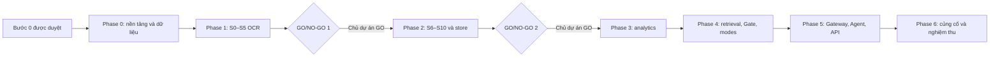

# Kế hoạch triển khai FinAgent — Phase 0 đến 6

Cập nhật02/11/2026. **Chủ dự án đã freeze14 nhóm và cho thực hiện P0.06–P0.11.** Sáu điều kiện freeze ghi tại ARCHITECTURE§13/ASSUMPTIONS và manifest. Phase0 chưa được nghiệm thu khi corpus/môi trường chưa đủ; dừng chờ xác nhận trước Phase1.

Nguồn và phạm vi đọc: [READING_NOTES.md](READING_NOTES.md). Hợp đồng: [ARCHITECTURE.md](ARCHITECTURE.md). Khoảng trống và đề xuất: [ASSUMPTIONS.md](ASSUMPTIONS.md). Kiểm thử và KPI: [TEST_PLAN.md](TEST_PLAN.md).

Backend theo Báo cáo chính v2.0; không UI, Sector Pack theo ngành, multi-agent hay tính năng mở rộng của Báo cáo 2. Core dùng thật EP1–EP12, `generic@1` và chiến lược `single`.

## 1. Baseline Bước0 và điều kiện đã duyệt

Các đoạn baseline dưới đây ghi thời điểm đọc Bước0 ban đầu; trạng thái code/Git/kiểm thử hiện hành xem PROGRESS, không suy từ mô tả lịch sử.

Đã đọc đầy đủ các tài liệu và xem cả 28 trang PDF FPT được bổ sung trong phiên. Đã tính lại ca vàng bằng số VND đầy đủ; kết quả làm tròn khớp yêu cầu. Đây là đối chiếu thủ công, chưa có pipeline, kernel, harness hoặc test sản phẩm.

Workspace chưa là repo Git, chưa có mã nguồn, manifests hoặc CI. Python được kiểm tra là 3.12.10; các thư viện PDF Python được dò chưa có. Việc xem PDF dùng bộ render có sẵn của Windows và ảnh tạm ngoài repo, không cài package hoặc viết parser sản phẩm.

Sau xác nhận Bước 0:

1. Kiểm tra lại hướng dẫn, cây workspace và Git status/diff nếu Git đã có; giữ mọi sửa đổi của người dùng.
2. Duyệt baseline schema, hợp đồng và các đề xuất trong ASSUMPTIONS; không tự biến đề xuất thành quyết định đã chốt.
3. Corpus do chủ dự án cung cấp: Phase0≥30 báo cáo có manifest nguồn/ngày/điều khoản/hash, trong đó≥10 gold approved; bổ sung gold ở Phase1–2, cuối Phase6≥100 gold. Không tự thu thập nếu chưa có danh sách nguồn cho phép bằng văn bản; không đếm bản sao/synthetic.
4. Generic Assessment v0 đã được duyệt làm cơ sở theo ASSUMPTIONS A25–A28; vẫn POLICY_UNAPPROVED cho tới khi chủ dự án duyệt kết quả chạy trên kho. Không hỏi lại các quyết định đã trả lời.

Bước0 ban đầu có năm tài liệu; theo yêu cầu ngày02/11/2026, bổ sung PROGRESS để ghi audit G1–G14 và trạng thái dừng. Đây không phải bắt đầu Phase0. Không cài package, global tool, plugin/MCP, tạo credential hoặc hook ở Bước 0. Sau khi kế hoạch được duyệt, dependencies dự án cần thiết được nêu rõ trong manifest; không cài global. Nếu dependency/tài nguyên mới mở rộng phạm vi đã duyệt, giải thích và xin phép trước. Không publish/deploy, migrate dữ liệu thật hoặc dùng API trả phí khi chưa có quyền tương ứng.

## 2. Phụ thuộc và quy tắc cổng

Không chuyển phase khi tiêu chí chưa đạt. Có thể xử lý các task độc lập trong cùng phase, nhưng không vượt cổng. Mỗi phase chạy toàn bộ suite đã có, cập nhật PROGRESS và báo kết quả. Theo §15/CLAUDE, cuối Phase 1 và 2 phải dừng chờ chủ dự án quyết định GO/NO-GO. Không tự tạo thêm cổng xin xác nhận cho từng task thường lệ. Nếu người dùng chỉ cho phép một phase, dừng ở cuối phạm vi đó.

Các mốc tuần 1–30 là ước tính của tài liệu cho nhóm 3–4 người, không phải cam kết thời gian cho phiên làm việc. Chủ dự án duyệt gold/review theo §17/§23. Không dùng sub-agent hoặc triển khai runtime multi-agent trong kế hoạch này.

**Tiêu chí chung của mọi task loader:** mọi đường nạp registry từ đĩa hoặc DB đều phải qua `registry.bundle`, có inventory và test không bypass (kể cả model/prompt registries). Task không được hoàn thành chỉ với parse DTO mà thiếu semantic gate. Mỗi lỗi/lỗ hổng sau freeze thêm ca sai vào schema_review_cases.json. Thêm giá trị finite enum closed là breaking; extensible hiện rỗng. P2.01 phải đóng cửa sổ canonical/1 ngay first real persistence, với audit/hash/ADR policy; không ghi thật trước điểm tích hợp đó.

## 3. Phase 0 — Nền tảng và dữ liệu (tuần 1–3)

**Đầu vào:** Bước 0 được duyệt, workspace, PDF FPT và kế hoạch corpus/quyền sử dụng. Các task theo thứ tự:

| ID | Công việc | Đầu ra và kiểm tra |
| --- | --- | --- |
| P0.01 | Kiểm kê Python, Docker, Make, PostgreSQL, Redis và quyền filesystem; kiểm Git và thay đổi có trước. Khởi tạo repo local nếu chưa có, không publish | Báo availability thật, không tự cài global hoặc nhận service đã chạy khi chưa quan sát |
| P0.02 | Tạo `pyproject.toml`, package/test/eval skeleton, dependency groups và lock/pin sau xác minh | FastAPI, Pydantic v2, psycopg, Redis client, HTTP client và công cụ test; chưa chọn framework Agent hay OCR engine |
| P0.03 | Cấu hình ruff, mypy strict cho analytics/validation/store, pytest, pre-commit, Dockerfile/compose, `.env.example`, Makefile và CI | Compose có Postgres/pgvector, Redis, API/worker profiles; Make targets có lệnh Python tương đương trên Windows |
| P0.04 | Hiện thực canonical/1 DTOs, tagged periods/measures, provenance, tenant/tier, policy/error schemas | Round-trip số lớn hơn 53 bit, không float tài chính, ràng buộc stock/flow và schema contract tests |
| P0.05 | Dự thảo schemas spack/template/rule/ratio/role/tool/model/event/api và **gateway/1, prompt/1, model-registry/1**; loader validators/dependency graph; snapshot tests; sửa R1–R7 và trình SCHEMA_REVIEW_SUMMARY đủ14 nhóm | **DỪNG, chỉ freeze khi chủ dự án xác nhận bằng chữ `freeze`.** Manifest có SHA256 từng snapshot, compat_policy và ca đúng/sai mỗi nhóm; catalog custom validators trong OpenAPI. Cùng bản chính chỉ thêm trường tùy chọn; breaking nâng bản chính kèm ADR, migration, full snapshots. Không auto-freeze bằng test/generate; sau freeze mới chuyển P0.06 |
| P0.06 | Chốt15 core/biến thể/rounding/basis, template/source catalog và draft Assessment policy | Mapping FPT theo hash quan sát, không gán321 cho mọi mẫu. **Mọi đường đĩa/DB qua registry.bundle, có tests không bypass**. POLICY_UNAPPROVED tới corpus-run approval; config declarations không thay kernel/evaluator |
| P0.07 | Tạo manifest/split/gold schema/dataset card, nhập FPT đúng hash/path, bản đồ trang và bất nhất nguồn | Bbox gán trên ảnh thật, đáp án từ PDF và gold được chủ dự án duyệt |
| P0.08 | Chỉ nhập các báo cáo thật hiện có trong data/public_reports; manifest nguồn/ngày/điều khoản/hash, strata và entity split | Giữ target≥30 complete manifests +≥10 gold approved. Lượt này **không thu thập thêm**, không copy/synthetic/silver thay chỉ tiêu; thiếu dữ liệu/nguồn/quyền/approval báo INSUFFICIENT_DATA |
| P0.09 | Privacy/mode schemas, query guard che số user, anonymizer token ngẫu nhiên mỗi run, value-blind egress contracts (D-GW-1–5) | Private mặc định; strict-private external=0; verify_user_claim chỉ placeholder; enum clarification/local templates; canary số user/claim/history, cross-run token test; không with_values |
| P0.10 | Xác minh capabilities/quota/terms qua **trang chính thức + limits trong tài khoản thật + điều khoản**, rồi synthetic probes khi có keys/quyền; tách runtime/dev keys/factories/account scope; đo model chép đúng alias8 ký tự qua prompt tổng hợp cho intent/compose | Ghi checked_at/evidence cho từng phần, quota source=manual_console\|probe\|header_hint, structured_strategy đã probe, training_use + retention và private.max_retention_days eligibility. Token-copy báo số case đúng/tổng, token đúng vị trí/tổng, thiếu/thừa/sai và model/version/task/usage; **không tự đặt ngưỡng**, chưa chạy ghi NOT_RUN. Provider order do **số đo** quyết định. Không chép quota/điều khoản từ thiết kế §20; thiếu quyền/keys →NOT_RUN từng phần, không suy từ mock hay key khác |
| P0.11 | Dựng eval CLI, metric schemas/reports/gates và baseline kiểm kê; tiếp tục docs/PROGRESS.md đã có entry Bước0 | K01/K16 và các phần NOT_EVALUATED rõ ràng; K19/K20 là đề xuất chưa ngưỡng, không bịa OCR/Agent/model metrics |

P0.10: riêng Google AI Studio, lấy hạn mức theo model từ trang limits của tài khoản thật; không suy số từ bảng công khai/tham khảo hoặc key khác. Console/probe/header_hint phải ghi nguồn và checked_at riêng; probe thành công không chứng minh mức trần hay điều khoản. Khi thiếu quyền tài khoản, phần limits/terms tương ứng là NOT_RUN dù đã đọc được trang chính thức. Không có số đo thì chưa chốt chuỗi provider.

Probe token-copy R1 dùng [bộ prompt tổng hợp](evidence/phase0/schema-review-r1-r7/token-copy-probe.json) và `python -m eval.token_copy_probe`; prepare/scorer không gọi provider. Unit responses không là model measurement. Cổng P0.05 đã mở; P0.10 [đã đọc nguồn chính thức](PROVIDER_REVIEW.md), account/live/token-copy vẫn NOT_RUN tới khi có quyền/khóa, không threshold tự đặt.

Pre-commit chỉ cấu hình và chạy thủ công/CI: **không `pre-commit install`, không Git/Codex lifecycle hook**. Không đổi global Codex settings.

Các lệnh sẽ được định nghĩa trong manifest/CI: `python -m ruff check .`, `python -m ruff format --check .`, `python -m mypy finagent`, `python -m pytest`, `pre-commit run --all-files`, `docker compose config`, cùng các Make targets `lint`, `typecheck`, `test`, `check`. Đây là lệnh dự kiến, chưa chạy ở Bước 0. CI chạy thật và phân biệt integration profile cần service.

**Hoàn thành Phase0 theo điều chỉnh đã duyệt:** kiến trúc được duyệt; schema dự thảo có snapshot/conformance tests và **được chủ dự án xem/duyệt rồi mới frozen tại P0.05**; P0.09 theo D-GW-1–8. Corpus≥30 báo cáo có manifest nguồn/ngày/điều khoản/hash, trong đó≥10 gold do chủ dự án duyệt, đủ hạn ngạch đa dạng; phần gold còn lại bổ sung Phase1–2. P0.10 phần official documentation phải có checked_at/evidence; live probes/account limits/terms account-specific giữ NOT_RUN tới khi có keys/quyền, tuyệt đối không gọi provider lúc chưa cấp keys, không lấy§20 làm registry evidence. Báo từng tiêu chí đã/chưa đạt, không gọi NOT_RUN là PASS hoặc chốt routes chưa đo. Full suite cần thiết phải chạy đạt; thiếu corpus hoặc cổng schema thì INCOMPLETE. Cuối Phase0 dừng chờ xác nhận trước Phase1; không yêu cầu API trả phí.

## 3.1. Ngoại lệ Phase 1a do chủ dự án cho phép ngày03/11/2026

**Phase0 vẫn INCOMPLETE / NO_GO; ngoại lệ này không mở Phase1 và không thay tiêu chí corpus.** Chỉ làm các phần độc lập dữ liệu sau; trạng thái thực tại PROGRESS.

| Phần được phép | Tiêu chí trong phạm vi ngoại lệ |
| --- | --- |
| P1.01 | IngestionGateway và BlobStore local, hash/MIME/page/zip/scanner/URL safety, tenant/tier/idempotency; memory jobs có lease/checkpoint/retry/cancel. Test offline và PDF thật có sẵn; không yêu cầu DB/Redis hoặc business HTTP ở đây |
| P1.02, phần không cần corpus | Router từng trang từ tín hiệu typed, không nhầm signature text thành body; render, xoay, chỉnh nghiêng, ảnh gốc/processed và transform thuận/nghịch. Native parser hoặc hệ điều hành thiếu tài nguyên ghi NOT_RUN, không coi routing trên tín hiệu giả là đã đọc native thật |
| P1.05, chỉ S5 | Chuẩn hóa số Việt Nam độc lập engine: nhóm3/chấm/phẩy/ngoặc âm/gạch/ô trống, role và unit rõ; không sửa theo equation/oracle và chưa canonical admission. S4 OCR candidates/disagreement chưa làm |
| Harness và công cụ corpus | Đo thời gian/memory theo thao tác, trace cục bộ không nội dung; lập manifest mới và xuất crop+giá trị ứng viên chỉ từ originals dưới data/public_reports. Không sinh approval, không sửa nguồn/gold, không nhân mẫu |

Không thực hiện P1.03 tinh chỉnh dữ liệu, P1.04 benchmark/chọn engine, P1.06 training, P1.07 teacher VLM, P1.08 đo KPI hoặc cổng GO/NO-GO1. Không chọn OCR engine hoặc báo OCR accuracy/KPI từ kiểm thử hình học. Provider live/token-copy/account limits, Docker/Postgres/Redis/hosted CI giữ NOT_RUN. Không thêm dependencies/global tools/hooks/Git config/ACL. Sau bàn giao **dừng chờ corpus≥30 complete manifests và≥10 approved gold cùng xác nhận của chủ dự án** trước phần còn lại Phase1. Hướng dẫn công cụ tại README; A64 ghi lựa chọn kỹ thuật chưa calibration.

## 4. Phase 1 — OCR cục bộ và huấn luyện (tuần 4–10)

**Phụ thuộc:** Phase 0 đạt, đặc biệt P0.04–P0.10 và corpus đã duyệt. **EP sử dụng:** EP3/4/6/11 và engine adapters.

| ID | Công việc | Kiểm thử và bằng chứng |
| --- | --- | --- |
| P1.01 | IngestionGateway, BlobStore, kiểm tra file/URL và job memory có checkpoint | MIME, hash, idempotency, giới hạn trang/zip, SSRF, tier; không gửi file cho OCR ngoài |
| P1.02 | Native parser, triage S0, render/orientation/deskew S1 | Dấu chữ ký số không làm cả FPT được coi native sạch; bbox transforms, trang ngang và hybrid |
| P1.03 | Tiền xử lý/layout S1–S2, cấu trúc bảng S3, giữ ảnh gốc/clean và phân vai cột | Bảng không kẻ ô, nhiều dòng, xoay ngang, dấu ký đè, merged cells |
| P1.04 | Benchmark local engine candidates §5.3 và chọn ≥2 đường OCR độc lập | Accuracy/CPU latency/RAM, license, weights/model version trên cùng cohort; không chọn chỉ theo FPT |
| P1.05 | S4 candidates/disagreement và S5 vi-VN normalization | Ngoặc âm, nhóm3, dấu chấm/phẩy, gạch0/missing, đơn vị và bẫy cột code/note |
| P1.06 | Huấn luyện/hiệu chỉnh thành phần nhỏ page/table/mapping trên public train/dev | Model hash, seed, training config, ablation và holdout thật; không giả đã train khi chỉ có luật |
| P1.07 | Teacher/public VLM labeling tùy chọn trong corpus/dev tooling riêng, tách command/factory/runtime imports/keys/budget | Chỉ public có source/rights đã duyệt; silver không thay gold. AST/import tests chặn runtime→teacher; key khác không tự chứng minh quota khác account_scope. Không có teacher key vẫn local OCR chạy, không đưa teacher thành fallback runtime |
| P1.08 | Chạy full suite và OCR harness trước kế toán | K02/K04/K18 theo strata, không repair/review trong numerator pre-validation; đo CPU/25 trang |

Nếu ablation chứng minh rule-only tốt hơn deliverable mô hình nhỏ, báo số đo và xin duyệt thay đổi deliverable, không lặng lẽ bỏ huấn luyện đã nêu ở §15.

**Bàn giao:** S0–S5 thực tế, adapters/model artifacts, benchmark report. **Hoàn thành:** ≥98% ô số đúng trước kế toán trên tập test đóng băng; báo riêng native/scan/ca khó và lỗi âm thầm. KPI cuối ≥99,5% native/≥98,5% scan vẫn được giữ. Full suite đạt; nhu cầu GPU dựa vào số đo CPU.

**GO/NO-GO 1 — dừng bắt buộc:** chủ dự án xem tests, metrics, cỡ mẫu, artifacts và giới hạn rồi quyết định. Chưa đạt hoặc chưa đủ dữ liệu thì tiếp tục Phase 1; không chuyển Agent hoặc tự hạ tiêu chuẩn.

## 5. Phase 2 — Hiểu báo cáo và kho chuẩn (tuần 11–15)

**Phụ thuộc:** GO 1 của chủ dự án và S0–S5 đã đạt. **EP sử dụng:** EP3/4/6/12.

| ID | Công việc | Kiểm thử và bằng chứng |
| --- | --- | --- |
| P2.01 | S6 nối bảng/dựng cây/memo; S7 template, code mapping, period/unit/scope | Mã FPT321/322/22/24, trang vật lý/in, không trộn scope hoặc cột thuyết minh |
| P2.02 | Rule Registry và S8 full catalog A–F, completeness | Mọi total có rule hoặc flag; thiếu input là NOT_EVALUATED, exact/rounded tolerance đúng |
| P2.03 | A–D trust, READ/SOURCE/CLASSIFICATION issues, S9 sửa ứng viên duy nhất có giới hạn | Property tests hỏng một ô, lỗi bù trừ, nhiều nghiệm; không tính ngược số thiếu |
| P2.04 | Postgres repositories, provenance, immutable snapshots/revisions/restatements | Atomic publish, không REJECTED admission, PARTIAL chỉ phần độc lập, không ghi đè nguồn |
| P2.05 | S10 Review API/CLI, crops/bbox/candidates, xác nhận/sửa/acknowledge source conflict | Audit, optimistic409, revalidate sau sửa; giữ OCR gốc và bất nhất nguồn |
| P2.06 | Memory/Redis parity, DB outbox/checkpoints và invalidation contracts | Crash/retry/dedup/lease và integration PostgreSQL/Redis thật |
| P2.07 | FPT-E01..E12, corpus validator và OCR sau validation/review | Shares conflict, interest/net-FX và nhãn công thức thiếu61; WARN hợp lý không biến thành lỗi đọc |

**Bàn giao:** S6–S10, store và review vận hành qua API/CLI. **Hoàn thành:** ≥90% report bundles VERIFIED, ô sai không cờ ≤0,1%, K03=100%, full suite đạt. Báo auto-only và sau review riêng; không bỏ PARTIAL/REJECTED khỏi mẫu số để tăng kết quả.

**GO/NO-GO 2 — dừng bắt buộc:** chủ dự án quyết định trên số đo thật. Chưa đạt thì tiếp tục OCR/mapping/rules/review trong Phase 2; không chuyển analytics/Agent hoặc dùng lập luận “đúng bằng thiết kế” thay gold evaluation.

## 6. Phase 3 — Phân tích (tuần 16–19)

**Phụ thuộc:** GO 2, canonical snapshots và definitions đã duyệt. **EP sử dụng:** EP1/2/5; generic pack phải qua loader thật.

| ID | Công việc | Kiểm thử và bằng chứng |
| --- | --- | --- |
| P3.01 | Safe expression evaluator/type checker, 15 core definitions khóa version và variants | Reject code/invalid units/cycles, Decimal38, không finance float |
| P3.02 | Ratio Kernel thực thi definitions; inputs/provenance/basis/formula/trust trong kết quả | FPT-R01..R15/V01/V02, zero/âm/missing/số lớn và period joins |
| P3.03 | Applicability rules generic cho holding, dividends, intra-group, tồn kho và tổ chức tài chính | N/A/NOT_MEANINGFUL có evidence, không nhánh tên FPT; các ngưỡng được duyệt/versioned |
| P3.04 | Cash mặc định/mở rộng, phải thu131/130, debt300 và borrowing references tự động | Exact warning130, missing reference không chặn main, không cộng trùng lease/bond |
| P3.05 | Piotroski 9 components và selectors annual/same-quarter/TTM | FPT-P01..P05, missing không=0, strict9/useful7, giữ source flag tại F7 |
| P3.06 | Trend, compare_periods và threshold store | ≥3 điểm mới trend, hai điểm chỉ change; gaps/restatements/comparability và nguyên nhân có nguồn |
| P3.07 | Sector Pack loader, generic@1 và Assessment có contributions/coverage/caps/confidence | Profile A25–A28 phải approved trước rating; draft trả POLICY_UNAPPROVED; industry không đổi điểm |
| P3.08 | Full suite và analytics harness; extension definitions/pack fixtures | Ratio không đổi theo pack/mode/provider khi cùng definition/basis/options |

**Bàn giao:** Kernel/Registry/Applicability/Piotroski/Trend/Assessment và kho ngưỡng chung hoạt động qua contracts, không stub. **Hoàn thành §15:** 100% ca tính tay, cờ130 đúng nguyên văn, references nợ vay tự động, toàn bộ tests đạt. Policy Assessment chưa duyệt là release blocker, không phải lý do bỏ module hoặc tuyên bố toàn bộ analysis đã hoàn chỉnh. Sai ca vàng phải được truy nguồn và ghi vào PROGRESS, không chỉnh test để khớp output.

## 7. Phase 4 — Retrieval, Gate, mode và Verifier (tuần 20–23)

**Phụ thuộc:** snapshots/analytics đã kiểm, local embedding artifact được chọn và cho phép. **EP sử dụng:** EP5/10/11/12.

| ID | Công việc | Kiểm thử và bằng chứng |
| --- | --- | --- |
| P4.01 | Chunk/index theo heading/note, metadata entity/scope/period/trust; local BM25/vector/rerank | Loại nhiễu hành chính, local-only model calls, không tenant leakage |
| P4.02 | Hybrid retrieval và extractive QA, spans/citations/fact links | Recall@k, citation precision, sai kỳ/scope, source conflict, số chưa xác minh trong quote |
| P4.03 | Policy hierarchy/tier merge và strict/useful Gate predicates | D chặn, C useful chỉ raw có nhãn, không C scoring; Assessment/official export strict |
| P4.04 | Typed AnswerSet local → FinalAnswerPayload mù giá trị → AnswerDraft segments → OutputValidator → LocalRenderer → OutputVerifier | T26/T27 chặn digits/names/ref lạ/thiếu claim-warning-status trước render; T29 cố ý lỗi renderer ROE/ROA/kỳ/giá trị để Verifier chặn; numbers và warning text do local chèn nguyên văn |
| P4.05 | Query guard che giá trị số user/history, verify_user_claim placeholder, token random mỗi run và egress whitelist | Canary không chứa giá trị claim/user, assistant answers/tool results/tables không ra ngoài; cùng entity khác token giữa runs; uncertain number/period hoặc pasted source →local; private/strict có local path |
| P4.06 | Template composer trả cùng typed AnswerDraft; local clarification templates, extractive endpoints và context connectors chỉ liệt kê nguồn | Template cũng qua OutputValidator/renderer/Verifier; không gửi số/raw report/news ra ngoài hoặc dùng industry đổi score; không streaming/hedging |
| P4.07 | Calibrate trên dev, freeze policy, chạy traps và expert claim labels | K07–K13 với cohort/cỡ mẫu/interval; không external verifier hoặc tune trên test |

**Bàn giao:** QA trích xuất/local có nguồn, Gate/modes/anonymizer, value-blind composer contracts và chuỗi OutputValidator → local renderer → Verifier dùng cho provider lẫn template. **Hoàn thành:** Layer N có 0 số sai không cờ, 0 số không truy vết; strict Q support≥99%, false ABSTAIN≤15%; useful support≥95%, false ABSTAIN≤5%, coverage≥90%; ABSTAIN recall và citation precision≥95%. Báo tử/mẫu và độ bất định, không xác nhận toàn bộ KPI bằng một PDF. Full suite đạt, canary composer/user-number/history và T26–T29 đạt; không draft bị chặn tới renderer/display; lỗi renderer được Verifier bắt. Câu hỏi hợp nhất FPT phải ABSTAIN đúng.

## 8. Phase 5 — Gateway, Agent đơn và API (tuần 24–27)

**Phụ thuộc:** Phase 4; keys/quota chỉ khi có quyền dùng. **EP sử dụng:** EP7/8/9/11/12 và kiểm mọi đường mở rộng còn lại.

| ID | Công việc | Kiểm thử và bằng chứng |
| --- | --- | --- |
| P5.01 | Bốn external adapters + mock; structured ladder native_schema→tool_call_schema→json_mode+local_validation→ineligible; routes theo P0.10 | QuotaStore (provider,account_scope,model), reserve/reconcile Redis nguyên tử khi nhiều worker, công bằng tenant; budget/circuit/cache/version tests; runtime/dev keys tách, paid tắt; local inference qua LocalModelPort |
| P5.02 | Hai task intent/compose mù giá trị, one-use EgressPermit mỗi attempt, typed OutputValidator và local fallback ports | Canary bytes/network-deny, required refs và prose guard; không raw tool results/financial values tới model; không streaming, không hedging, retry tuần tự trong budget |
| P5.03 | Role Registry, đúng16 tools, single strategy, enum clarification + câu hỏi mẫu local; session version/ACL và user-only masked history A54 | T01–T29, đặc biệt T14/T28: không assistant answers/tool results trong outbound history; đổi context retokenize, không chọn latest ngầm; quyền review/stop conditions, không supervisor/spawn |
| P5.04 | Hoàn thiện FastAPI/CLI/auth/admin/tenant/privacy/config/jobs theo contracts | OpenAPI/compatibility, endpoints thật, production readiness không giả |
| P5.05 | SSE/replay/ACL, crops/bbox, public explanations, webhook opt-in tối thiểu | SSE chỉ tiến độ metadata an toàn + result_ref; client GET kết quả hoàn chỉnh sau Verifier, không answer/token/partial stream. Replay/SSRF/tier inheritance, không hedging (A60) |
| P5.06 | JSON/Markdown/Excel export; official strict re-evaluation | Formula/provenance, exact130warning, source conflicts/N/A/missing; spreadsheet injection |
| P5.07 | Kịch bản đầu-cuối native/scan/office/text/URL/review/revision/partial/rejected | Service/API thật local; mất mọi provider vẫn core+template chạy; SCOPE_MISMATCH đúng |
| P5.08 | Full suite/privacy/Agent harness; live parity khi được phép; baseline **K19 draft rejection theo model, K20 template fallback** (A57) | Báo tử/mẫu/task/tier/reason/first-final attempts; forced-local và renderer lỗi tách model lỗi. Ngưỡng chất lượng **chờ duyệt**, không tự đặt; live tách mock, usage/cost thật, không paid ngoài ngân sách |

**Bàn giao:** single Agent dùng được đầu-cuối qua API/CLI, Gateway đổi adapter được, tenant/jobs/events/security/export/admin đầy đủ. **Hoàn thành §15:** kịch bản đầu-cuối đạt và tests chứng minh không có đường runtime gửi tài liệu ra ngoài; strict-private external calls=0, paid-disabled không gọi paid provider. Mọi output qua OutputValidator → renderer cục bộ → Verifier; các ca multiworker atomic quota/fairness, tách dev/runtime, structured ladder, privacy terms và no-stream/no-hedge phải đạt. K19/K20 có baseline thật khi được phép, chưa có ngưỡng thì ghi PENDING_APPROVAL, không tự kết luận chất lượng theo model đạt. Backend template có thể hoạt động khi thiếu model, nhưng chất lượng/quota live chưa đo vẫn phải báo NOT_RUN.

## 9. Phase 6 — Củng cố backend (tuần 28–30)

**Phụ thuộc:** Phase 0–5 dùng được, policy nghiệp vụ được duyệt, corpus và tài nguyên đánh giá thật. Không giả có ≥100 gold reports hoặc expert labels.

| ID | Công việc | Kiểm thử và bằng chứng |
| --- | --- | --- |
| P6.01 | Mở corpus ≥100, duyệt gold, freeze holdout và audit nguồn/split | Báo số unique reports, cells, strata, entity leakage; private pilot riêng |
| P6.02 | Chạy toàn bộ eval OCR/validation/analytics/retrieval/Agent/modes/security | K01–K18 với tử/mẫu, artifacts, lệnh tái lập và confidence intervals |
| P6.03 | Red team file/URL/injection/DSL/tenant/cache/crop/SSE/export/log/retention/egress | 0 privacy/tenant/paid bypass, không default-on tính năng ngoài core |
| P6.04 | CPU latency/load/recovery/quota và **nhiều worker Redis đồng thời, nhiều tenant**; benchmarks25 trang | Không vượt account/model/tenant reservations hoặc chiếm quota tenant khác; đo fairness theo cấu hình đã duyệt. Native<30s, scan<180s, QA p95<15s giữ nguyên; GPU cần số đo/quyền, không tự thuê |
| P6.05 | Đánh giá provider thật, chốt routes theo số đo capability/structured_strategy/terms/quota/latency/parity; đo K19/K20 theo model (A57) | Removed model/429/circuit/budget/invalid draft/template fallback; ngưỡng K19/K20 **chờ chủ dự án duyệt sau baseline**, không tự đặt/giảm KPI. Thiếu live resource →NOT_RUN từng phần; không ranking provider cố định hoặc dùng dữ liệu §20 |
| P6.06 | OpenAPI/runbook/API-CLI examples, deployment profiles, backup/restore/retention/config guide | Vận hành không UI; kiểm availability của dependency/model weights thật |
| P6.07 | Rà diff/contracts/import graph/12EP/schema compatibility và full suite cuối | Không unrelated refactor, không đổi nguồn gốc, mọi check bắt buộc đã chạy đạt |
| P6.08 | Báo cáo nghiệm thu và PROGRESS theo cohort/hardware/scope đã đo | Chỉ đề nghị complete khi mọi cổng đạt và không còn software BLOCK |

**Tiêu chí cuối:** KPI §2/§19 và mọi tiêu chí phase được chứng minh bằng tests/eval: native≥99,5%, scan≥98,5%, silent cell error≤0,1%; Layer N không số sai không cờ/không truy vết; ABSTAIN recall và citation precision≥95%; Q targets của từng mode; hiệu năng; 100% interfaces/tool schemas; ≥100 gold reports; không software BLOCK. Source WARN như cổ phiếu FPT vẫn phải hiện, không bị xóa để đạt KPI.

Thiếu dữ liệu/tài nguyên thì báo phần đã đo, harness đã chạy và phần chưa xác nhận; không đánh dấu backend hoàn thành. Không publish/deploy production tự động. UI, Sector Packs theo ngành và multi-agent cần một yêu cầu triển khai riêng sau core.

## 10. PROGRESS và hồ sơ cổng

Entry Bước0 sửa đổi được tạo theo yêu cầu trực tiếp ngày02/11/2026; sau đó chỉ cập nhật `docs/PROGRESS.md` trong phase đã được cho phép, không tạo persistent memory/handoff/changelog trùng lặp. Mỗi entry phải có:

- Trạng thái `IN_PROGRESS / IMPLEMENTED_NOT_VALIDATED / INCOMPLETE / VERIFIED`, module/files và requirement IDs.
- Commands thật, thời gian, exit status, test summary, NOT_RUN kèm lý do; service/model/dataset/hardware versions.
- Metric ID/threshold, tử/mẫu, strata, estimate/interval, artifact và lệnh tái lập; điều chưa thể xác nhận.
- Sai lệch ca vàng: nguồn, inputs/formula/basis/precision, kỳ vọng/thực tế, nguyên nhân và assumption IDs; không tự sửa test để pass.
- Corpus/quyền sử dụng/hardware/keys/budget approval còn thiếu và task phụ thuộc.
- Cổng Phase 1/2: GO/NO-GO do chủ dự án, bằng chứng đạt/chưa đạt và next tasks; im lặng không là GO.

**Điểm dừng hiện tại:** P0.05 đã freeze; các việc P0.06–P0.11 có trạng thái chi tiết trong PROGRESS. Thiếu corpus/kiểm chứng môi trường thì Phase0 vẫn INCOMPLETE/NO_GO. Dừng chờ xác nhận trước Phase1, không hỏi lại freeze hoặc các quyết định cơ sở.

## 11. Ma trận truy vết

| Yêu cầu | Task/phase | Chứng cứ |
| --- | --- | --- |
| §4.3/6/14 interfaces/canonical | P0.04–05, P2.04 và contracts từng phase | K01, import graph, schema/adapter suites |
| §5 S0–S5 | P1.02–08 | K02 trước kế toán, benchmark và model artifacts |
| §5 S6–S10/§7/review | P2.01–07 | FPT-E01..E12, K03–K05, review audit |
| §9/20 analytics | P3.01–08 | FPT-R/P/REF/V, K06, approved policies |
| §8/19 Gate/Verifier/modes | P4.02–07, P5.05–06 | T01–T28, K07–K13, output receipts |
| Gateway G1–G14, D-GW-1–8 | P0.05/09/10, P1.07, P4.04–06, P5.01–03/08, P6.04–05 | Audit trước/sau trong PROGRESS; GW01–GW14, T05/14/26–29, K19/K20 chưa ngưỡng |
| §12/18/24 privacy/Gateway | P0.09–10, P4.05, P5.01–08, P6.03–05 | K15, serialized egress, tenant/red team, live/mock distinction |
| §22 EP1–EP12 | P0 contracts, P2 templates/rules, P3 registry/pack, P5 role/tool/Gateway/events | 12 extension conformance groups và core dùng generic qua loader |
| §23 backend/API/CLI/export/docs | P2.05, P5.04–07, P6.06 | End-to-end không UI, OpenAPI, SSE/crops và official strict |
| §15, KPI §2/19 | P0.11, eval từng phase, P6.01–08 | PROGRESS, hai quyết định GO, số đo corpus/hardware thật |

**Cổng đang áp dụng:** freeze đã được chủ dự án xác nhận; chưa có xác nhận Phase1. Các điều kiện30 complete manifests/10 gold và KPI khác giữ nguyên, không hạ để qua cổng.
